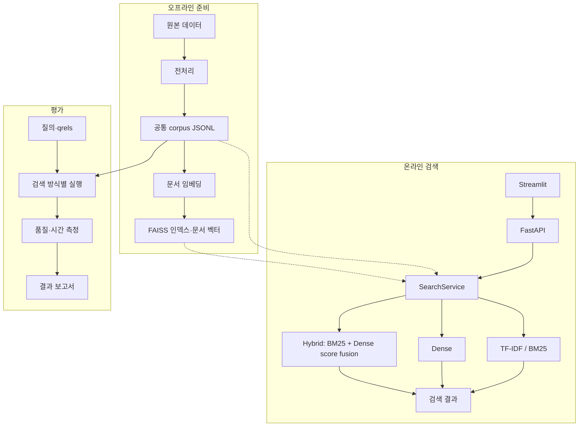

# 아키텍처

데이터 준비·인덱스 생성은 오프라인으로 수행하고, 검색 서비스는 준비된 데이터를 재사용합니다.

## 전체 흐름

```text
오프라인
원본 데이터 → 전처리 → 공통 corpus JSONL → 문서 임베딩 → FAISS 인덱스 저장

온라인
Streamlit → FastAPI → SearchService → TF-IDF / BM25 / Dense / Hybrid → 검색 결과
                         ↑
                 corpus·저장 인덱스 로딩

평가
corpus·질의·qrels → 검색 방식별 실행 → 품질·시간 측정 → 결과 보고서
```



## 구성 요소

| 경로 | 책임 |
| --- | --- |
| `data/`, `indexing/` | 데이터 준비, 문서 벡터와 FAISS 인덱스 관리 |
| `retrievers/` | 공통 검색 계약과 TF-IDF·BM25·Dense 구현 |
| `fusion/` | BM25·Dense score fusion 및 RRF baseline |
| `app/` | 서비스 초기화, 검색 방식 선택, HTTP 요청·응답 처리 |
| `frontend/` | API를 호출하는 검색·비교 UI |
| `evaluation/`, `scripts/` | 품질·시간 평가와 작업별 CLI |

## 주요 설계

- 검색기는 `search(query, top_k) -> list[SearchResult]` 계약을 공유합니다.
- 서버 시작 시 검색기를 초기화하고, 요청마다 인덱스를 다시 만들지 않습니다.
- Dense는 저장된 문서 벡터를 사용하며 검색 시 질의를 임베딩합니다.
- API의 `hybrid`는 score fusion입니다. 평가 CLI에서는 `rrf`와 `score_fusion`을 구분합니다.
- 검색기 원점수의 의미가 다르므로 UI에서는 순위와 공통 문서를 비교합니다.

세부 계약은 [스키마](SCHEMAS.md), 결합 방식은 [Score fusion](SCORE_FUSION.md),
초기화와 실행 절차는 [검색 서비스](SEARCH_SERVICE.md)를 참고하세요.
