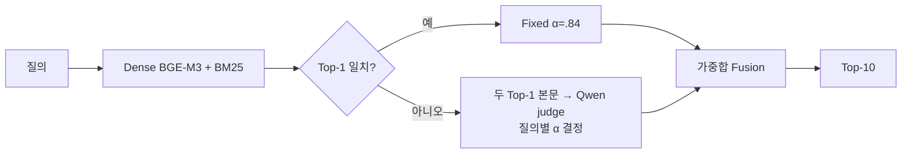

# BC Card DAT-style contextual weighting

**공식 비합성 Test 721개에서 DAT는 동일 조건 Fixed보다 nDCG@10이 낮고(.7910 → .7775), 평균 latency는 1.84배 증가했다(35.49 → 65.28ms).**

## 적용 범위와 구조

Dense/BM25 **Top-1이 다를 때만 두 후보 본문을 읽고 질의별 가중치를 결정**한다. 원 DAT의 생성형 LLM effectiveness 평가를 그대로 재현한 것이 아니라, 로컬 relevance judge로 contextual weighting을 제한적으로 적용한 실험이다. 추가 학습·외부 추론 API 호출은 없다.



- **데이터·검색:** corpus 36,281 chunks, Test 721개. `BAAI/bge-m3` FP32(revision `5617a9f`), 고정 문서 벡터, BM25 `char_wb` 2–4 gram·k1=1.5·b=.75·Lucene scoring.
- **Judge:** 로컬 `Qwen/Qwen3-Reranker-0.6B` BF16(revision `e61197ed`). Instruction·질의·본문을 Dense→BM25 순서로 입력하고 no/yes logits의 softmax에서 yes 확률을 얻는다. System/answer suffix 포함 2,048토큰이며 초과 시 본문 앞부분과 suffix를 보존한다.
- **가중합:** 확률 `pD`, `pB`를 `[1e-7, 1−1e-7]`로 clip하고 `odds(p)=p/(1−p)`, `α=odds(pD)/(odds(pD)+odds(pB))`로 Dense 비중을 정한다. Top100 합집합의 각 채널 실제 점수를 min-max 정규화해 `α×Dense+(1−α)×BM25`로 결합한다. 동점은 corpus ID 순서로 처리한다.
- **Fixed·fallback:** 공식 비합성 Validation 745개의 binary nDCG@10으로 정규화 4종 × α 101개 중 `union_minmax`, `α=.84`를 선택했다(Validation nDCG@10 `.8054856659`). `dat_fixed`는 항상 이 정책을 쓰고, DAT도 Top-1 일치 시 judge 없이 같은 정책을 쓴다.
- **정책·해석:** DAT odds 규칙은 기존 SQuAD 실험에서 고정했고 BC Test에 맞춰 수정하지 않았다. 다만 Test는 이전 실험에 노출된 데이터이므로 **탐색적 비교이며 독립적인 신규 held-out 검증이 아니다.** 원 DAT 전체 재현이나 adaptive weighting 일반의 실패로 해석하지 않는다.

구현: `fusion/contextual.py`, `fusion/contextual_judge.py`, `evaluation/contextual*.py`. 실행 진입점: `scripts/evaluate_contextual.py`.

## 결과와 비교 기준

| 구분 | Method | P@1 | Recall@10 | MRR@10 | nDCG@10 | Mean ms | P95 ms |
|---|---|---:|---:|---:|---:|---:|---:|
| Main canonical 재현 | `bm25` | .4189 | .7406 | .5232 | .5755 | — | — |
| Main canonical 재현 | `dense` | .6560 | .8988 | .7460 | .7835 | — | — |
| Main canonical 재현 | `score_fusion` | .6852 | .8946 | .7615 | **.7940** | — | — |
| DAT 동일 조건 비교 | `dat_fixed` | .6768 | .8932 | .7577 | **.7910** | 35.49 | 58.21 |
| DAT 동일 조건 비교 | `dat` | .6630 | .8835 | .7431 | .7775 | 65.28 | 128.40 |

**DAT의 직접 비교 대상은 `dat_fixed`다.** 두 방식은 문서 벡터·검색 경로·정규화·측정 환경이 같고, Top-1 불일치 시 judge로 α를 정하는지만 다르다. Canonical Fixed는 전체 corpus의 `Dense + 0.05×BM25/corpus-max`로, DAT용 Fixed와 fusion 정의가 다르다. Method·run ID를 분리하며 과거 내부 Dense `.7829`도 canonical `.7835`와 같은 baseline으로 취급하지 않는다.

### 벡터와 재현 한계

PR #28 원본 `document-vectors.npy`는 현재 없고 SHA-256만 남아 있다. 이번에는 동일 BGE-M3 revision·FP32·batch size 1·corpus·문서 순서로 벡터를 재생성한 뒤 고정했다.

| 문서 벡터 | SHA-256 |
|---|---|
| PR #28 원본 | `44c7899574c68a4b242b4e8d0eee9670c24ffe1793f8aed8f8524649f259be5a` |
| 이번 DAT 평가 | `4d5f1c8d9002bfeac0c7a927aa641b0ab17199ea008ea196fab786b08bb3df3a` |

Canonical은 FAISS FP32 단건 검색, DAT/`dat_fixed`는 재생성 FP32 벡터를 CPU float64로 변환한 NumPy 내적을 사용한다. Canonical 경로 재실행 시 PR #28의 세 방식·네 집계 지표가 절대 오차 `1e-12` 이내로 일치했다. 이는 **집계 성능 재현이며 원본 벡터 값·바이트 또는 모든 질의 순위의 동일성을 보장하지 않는다.** 새 캐시의 SHA가 기존 기록과 다르면 별도 run으로 구분하고 기존 결과와 혼합하지 않는다.

### Latency 측정

RTX 4060 8GB, CPU·BLAS/OpenMP 2 threads, 단건 인코딩·검색, judge batch 2. Validation 10질문/방식 워밍업 후 Test를 3회 실행했고, 첫 회차를 품질·추가 워밍업으로 제외해 방식별 1,442건의 mean/p95를 계산했다. 순서는 seed `20261030`으로 섞었으며 GPU 동기화, query vector·score·judge 결과 cache 비사용 조건이다. Judge 입력 잘림은 전체 회차에서 0건이었다.

측정 범위는 질의 토큰화·인코딩 → 검색 → 필요 시 judge 토큰화·추론 → 결합·Top10이다. 모델·인덱스 로딩, qrels 평가·저장, HTTP 시간은 제외한다. **같은 측정 회차의 DAT/`dat_fixed`끼리 비교하며**, CPU thread·정밀도가 다른 QDAP 등과 속도 순위를 매기지 않는다. 단계별 시간은 `results.json`에 보존했다.

## 전달 산출물과 검증

`docs/validation/2026-10-31/dat/`:

| 파일 | 보존 내용 |
|---|---|
| `protocol.json` | Schema v2, dataset/corpus/query/qrels identity·SHA, query 순서 hash, 모델 revision·원 실행 코드/설정 hash, method별 run ID, Validation 선택·환경·결과 SHA |
| `results.json` | 5방식의 P@1·Recall@10·MRR@10·nDCG@10, 단계별 latency mean/p95, canonical baseline audit |
| `per-query.jsonl` | **721개 × 5방식 = 3,605행**. Run/query ID, 네 지표, Top10 문서 ID·relevant rank, DAT selected α/mode·Top-1·judge 확률 |
| `latency-samples.json` | 첫 회차 포함 **4,326건**의 query/method/repeat별 전체·단계 시간 |
| `verification.json` | 기존 결과 재검증·테스트·정적 검사 기록 |
| `judge-smoke.json` | 실제 로컬 judge 로딩·두 본문 추론의 환경·모델/소스 hash·원시 logits·확률 |

통합은 기존 순위·시간의 변환이며 새 inference가 아니다. Query 순서 hash는 UTF-8 ID를 LF로 연결하고 마지막 LF 없이 SHA-256을 계산한다. 체크포인트·전체 벡터·질의/문서 원문·과거 배치 DAT 결과는 Git에 넣지 않는다.

**Paired CI, Finance vs Kanana, oracle/headroom·disagreement·slice·Fixed-vs-DAT 승패 분석은 이번 범위에서 제외한다.** Oracle은 계산하지 않았고 JSONL의 oracle 필드는 `null`이다. Finance encoder의 학습·checkpoint 요구사항은 별도 #35 범위다.

`verification.json`의 `validated_code_commit`은 검증 실행 당시 체크아웃한 커밋이며, squash 후 조상 관계를 요구하지 않는다. 검증한 코드·테스트의 동일성은 `source_sha256`으로 확인한다. 이전 실행 기록은 `previous_validation`에 보존한다.

`verify`는 입력·결과 SHA, 공식 721개 ID·순서, query/method 누락·중복·run ID를 검사한다. Top10·qrels에서 네 지표·relevant rank·집계를 재계산하고, frozen Fixed 정책과 DAT 분기·확률·α·fallback 순위, 시간 표본 조합·단계 합·첫 회차 제외 통계도 대조한다. 준비된 dataset이 필요하며 모델·벡터·GPU는 필요 없다.

```bash
uv sync --locked --extra dense --extra sparse
uv run --no-sync python -m scripts.evaluate_contextual verify \
  --data /data/bccard --output docs/validation/2026-10-31/dat
```

## 새 실행

Dataset·vector cache 준비는 [BC Card 평가 문서](BC_CARD_DATASET.md)를 따른다. 입력 manifest·문서/질의 순서·SHA가 일치하는 `encoding.json`, `document-vectors.npy`, `query-vectors-<split>.npy`가 필요하다. 전체 revision·설정·입력 SHA는 `protocol.json`을 기준으로 확인한다. **PR #28 원본 캐시와 같은 SHA 재생성은 보장하지 않으며 기존 출력은 덮어쓰지 않는다.**

```bash
# Test qrels 없이 Validation에서 Fixed 선택
uv run --no-sync python -m scripts.evaluate_contextual select \
  --data /data/bccard --vector-cache /data/vectors --output /runs/dat-policy.json

HF_HUB_OFFLINE=1 TRANSFORMERS_OFFLINE=1 \
uv run --no-sync python -m scripts.evaluate_contextual evaluate \
  --data /data/bccard --vector-cache /data/vectors --policy /runs/dat-policy.json \
  --encoder-model /models/bge-m3 --judge-model /models/qwen3-reranker-0.6b \
  --output /runs/dat-live --run-id dat-live --repeats 3

uv run --no-sync python -m scripts.evaluate_contextual baseline \
  --data /data/bccard --vector-cache /data/vectors \
  --canonical-summary docs/experiments/bccard/test-summary.json \
  --output /runs/dat-baseline --run-id dat-baseline

# 검증된 schema v2 결과 통합; 모델 재실행 없음
uv run --no-sync python -m scripts.evaluate_contextual combine \
  --data /data/bccard --baseline /runs/dat-baseline --live /runs/dat-live \
  --output /runs/dat-combined
```

Judge adapter 단위 테스트는 모델 다운로드 없이 실행하며 no/yes 확률·입력 순서·padding·잘림·forward 호환성을 검사한다. 실제 모델 테스트는 `DAT_JUDGE_MODEL` 미지정 시 건너뛴다.

```bash
uv run --no-sync pytest tests/fusion/test_contextual_judge.py -q

HF_HUB_OFFLINE=1 TRANSFORMERS_OFFLINE=1 \
DAT_JUDGE_MODEL=/models/qwen3-reranker-0.6b DAT_JUDGE_DEVICE=cuda \
DAT_JUDGE_SMOKE_OUTPUT=/tmp/dat-judge-smoke.json \
uv run --no-sync pytest tests/fusion/test_contextual_judge_live.py -q -s
```

2026-10-31 RTX 4060/BF16 실모델 smoke는 통과했고 snapshot hash는 기존 DAT judge와 일치했다. 검증 범위는 모델 로딩과 두 본문의 확률 반환까지이며 **721개 benchmark 재실행은 아니다.**
