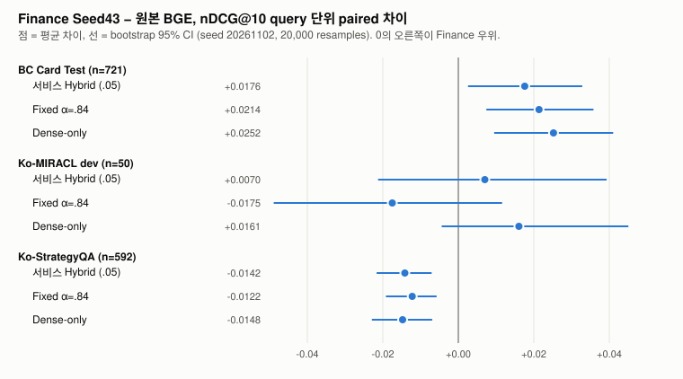
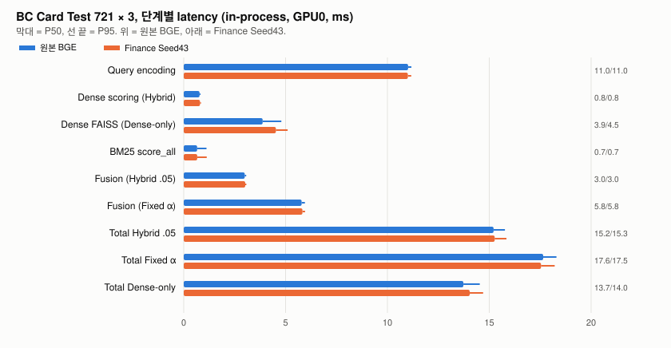

# Finance encoder 서비스 경로 검증

Finance Seed43은 실제 검색 서비스 경로에서도 BC Card 개선을 유지했음. 사전 등록한 두 co-primary 모두 Test nDCG@10 paired CI 하한이 0보다 큼. 사후에 고정한 다중 비교 보정 후에도 하한이 0보다 크지만, 서비스 Hybrid 쪽은 여유가 작음. 비용은 원본 BGE와 차이가 측정되지 않았음. 같은 architecture에 마지막 4 block 가중치만 다르기 때문임. 반면 금융 밖 Ko-StrategyQA에서는 세 조건 모두 유의하게 나빠졌고, Ko-MIRACL은 50개라 결론을 낼 수 없었음. 금융 특화와 범용 성능 사이에 trade-off가 관찰됨.

사전 등록은 [`preregistration.md`](validation/2026-11-02/finance-service-eval/preregistration.md)이고 구현·측정 전에 커밋했음(`5506f11`). Evidence는 [`finance-service-eval/`](validation/2026-11-02/finance-service-eval/)에 있음. 측정에 쓴 코드는 `5168591`임. 그중 `scripts/evaluate_finance_service.py`는 parity·accuracy·staged latency를 돌린 뒤 HTTP 하네스의 `_server`/`_wait_ready`만 고쳤고, 커밋된 버전은 성공한 HTTP 측정에 쓴 버전임. `60a0dc7`은 lint 정리만 했음(AST 비교상 미사용 import와 `staged_latency`의 timing 표기만 다름). 측정 뒤 추가한 base model identity 검증(`9a87625`)과 다중 비교 보정(`a0b9523` 이후)은 아래 각 절에 따로 적었음.

## 기존 시스템과 이번에 새로 검증한 것

서비스는 `app.api` → `SearchService` → retriever 구조임. `hybrid`는 `ScoreFusionRetriever`로 전체 corpus에서 `Dense + 0.05×BM25/max(BM25)`를 계산하고 동점은 document_id 순임. α가 없음. Dense query는 `DenseEmbedder`가 FP32 `SentenceTransformer.encode`로 인코딩함(`max_seq_length` 8192).

PR #40/#41의 Finance 평가는 이 경로를 쓰지 않았음. 저장된 BF16·512 tokens query vector를 읽어 `evaluation/query_encoder.py`의 Fixed fusion(Top100 union, union min-max, `α·Dense+(1−α)·BM25`, 동점 corpus 순)으로 순위를 매김. 서비스에는 checkpoint를 읽는 경로도 없었음. 그래서 이번에 새로 확인한 건 세 가지임.

- 서비스가 Finance checkpoint를 실제로 load해서 FP32로 인코딩했을 때의 결과
- 서비스 기본 Hybrid(.05 결합식)에서의 효과
- HTTP 요청부터 ranked documents 반환까지의 비용

PR #40/#41과 같은 오프라인 계산은 다시 돌리지 않고 parity check로만 썼음.

기존 Ko-StrategyQA·Ko-MIRACL 평가(`docs/experiments/score-fusion/`)와 BC Card 평가는 직접 비교하지 않음. 외부 평가는 `score_0.05`(서비스 결합식)를 썼고 α Fixed는 없음. 정답 정의도 다름. StrategyQA는 query당 평균 1.9개 relevant이고, MIRACL은 relevance 0 항목이 qrels에 같이 들어 있음. BC Card는 chunk 단위 graded label을 binary(> 0)로 씀. 평가 단위와 query 수(721 / 592 / 50)도 다름. 그래서 데이터셋별 절대 점수 대신 같은 데이터셋 안의 Finance − BGE 차이만 봤음.

## 구현

- `retrievers/adapted_query.py`: 원본 snapshot을 로컬에서 읽어 마지막 4 block에 checkpoint를 load하는 query 전용 embedder. 인코딩은 서비스 `DenseEmbedder._encode`를 그대로 씀. 문서 인코딩은 거부함. Identity 검증은 아래 절에 있음.
- `app/service.py`, `app/api.py`: `QueryCheckpoint`와 `DENSE_QUERY_CHECKPOINT`, `DENSE_QUERY_CHECKPOINT_IDENTITY`, `DENSE_QUERY_BASE_MODEL` opt-in. 셋 다 없으면 동작은 전과 같고, 일부만 있으면 시작할 때 오류를 냄. Checkpoint 적용에 실패하면 Dense와 Hybrid만 `load_failed`가 되고 BM25는 그대로 동작함. `SearchService.retriever()` 읽기 accessor를 추가했음.
- `fusion/minmax.py`: α Fixed fusion을 retriever로 옮긴 것. 평가에서 `SearchService`의 `hybrid` 자리에 주입해서 API로 호출함. API schema와 서비스 기본 Hybrid는 바꾸지 않았음.
- `evaluation/finance_service.py`, `scripts/evaluate_finance_service.py`, `scripts/analyze_finance_service.py`: 평가, 측정, 분석, 검증 스크립트.

문서 vector는 원본 BGE-M3 FP32 cache를 FAISS 인덱스로 저장해서 서비스가 `DenseRetriever.load`로 읽게 했음. 두 encoder가 같은 인덱스와 BM25를 쓰고 query encoder만 다름. Finance checkpoint는 PR #41 재현 run의 Seed43 step 4096(`fbbd5ed0…`)임. PR #40 원래 checkpoint(`d36f5c66…`)는 로컬에 없어서 쓰지 않았음.

### Base model identity 검증

측정 뒤 리뷰에서 adapter가 base snapshot이 checkpoint 학습에 쓴 모델과 같은지 확인하지 않는다는 점이 나와서 추가했음(`9a87625`). 이제 checkpoint마다 identity 파일(`config/query_checkpoints/finance-seed43-fbbd5ed0.json`)이 필요함. 이 파일은 `scripts/make_query_checkpoint_identity.py`가 학습 run의 `frozen.json`, 학습 `protocol.json`(SHA가 `frozen.json`에 묶여 있음), cache `encoding.json`에서만 값을 가져와 만듦.

서비스는 시작할 때 네 가지를 확인함. 하나라도 다르거나 identity가 없으면 Dense와 Hybrid를 `load_failed`로 두고 BM25만 열어 둠(fail-closed).
- Checkpoint 파일 SHA-256
- Base snapshot 파일 해시 집합. 학습 기록과 같은 규칙(`.bin`·`.safetensors`·`.json`·`.model`)이고 추가·누락 파일도 불일치로 봄.
- 인덱스에 저장된 embedding model 이름과 revision
- Layer 수

인덱스 쪽은 문서 vector를 만든 모델의 파일을 다시 확인할 수 없고 저장된 이름·revision 문자열만 비교함. 이 한계는 남아 있음. Snapshot 해싱은 시작 시간에 약 1.5초를 더함. 기본 경로(checkpoint 미설정)는 바뀌지 않음.

이 identity로 다시 띄운 Finance 서비스는 커밋된 A-fin·D-fin top10을 721개 모두에서 그대로 재현했음. HF hub cache 전체 snapshot은 쓰이지 않는 `onnx/` 파일까지 포함해서 해시 집합이 달라 거부됨. 고정한 10개 파일만 받은 snapshot을 써야 함.

## 경로 일치 확인

네 가지 모두 통과했음(`parity.json`, `accuracy.json`).

1. Adapter로 load한 checkpoint를 BF16·512·batch 16으로 돌리면 PR #41 Validation vector 1,000개와 bitwise로 같음.
2. α Fixed adapter에 PR #41 BF16 Test vector를 넣으면 PR #41 per-query top10과 지표가 721개 × 3개 방법 모두에서 같음.
3. 서비스 Hybrid·Dense에 cached FP32 BGE query vector를 넣으면 main contract replay(`docs/validation/2026-10-30/qdap/main-baseline-per-query.jsonl`) top10과 721개 모두 같음.
4. 모든 조건에서 `POST /search` 응답 top10과 retriever 직접 호출 결과가 같음.

사전 등록에는 3번 기준을 `test-summary.json`으로 적었는데, 그 파일에는 per-query 결과가 없고 다른 cache(`44c78995…`)로 계산한 것이었음. 그래서 같은 원본 cache로 서비스 결합식을 재계산한 qdap replay를 기준으로 썼음. 집계값은 같음.

서비스 FP32로 인코딩한 query vector는 PR #41 BF16 vector와 cosine 최소 .99969(BGE .99978)임. B-fin의 top10은 721개 중 142개가 PR #41과 다르지만 nDCG@10이 바뀐 query는 없음. 순위 차이가 비관련 문서 사이에서만 났음.

## BC Card Test 정확도

721개 primary query, `top_k=10`, 모두 API 경로로 받은 결과임.

| 조건 | 결합 | P@1 | Recall@5 | Recall@10 | MRR@10 | nDCG@10 |
|---|---|---:|---:|---:|---:|---:|
| A-bge | 서비스 Hybrid .05 | .685160 | .848821 | .894591 | .761462 | .794015 |
| A-fin | 서비스 Hybrid .05 | .690707 | .882108 | .918169 | .776703 | .811605 |
| B-bge | Fixed α=.84 | .676838 | .850208 | .893204 | .757738 | .791013 |
| B-fin | Fixed α=.84 | .692094 | .882108 | .919556 | .777347 | .812386 |
| S-fin89 | Fixed α=.89 (secondary) | .692094 | .883495 | .918169 | .778335 | .812883 |
| D-bge | Dense-only | .656033 | .855756 | .898752 | .746006 | .783509 |
| D-fin | Dense-only | .689320 | .882108 | .918169 | .773149 | .808735 |

A-bge .794015와 D-bge .783509는 main canonical 값과 같음. 서비스에서 live FP32로 인코딩해도 canonical이 그대로 재현됐음. B-bge .791013은 기존 내부 FP32 Fixed 값과 같음.

Finance − BGE paired 차이. Seed 20261102, 20,000 resamples, percentile 95% CI.

| 비교 | nDCG@10 | Recall@5 | Recall@10 | MRR@10 | P@1 | W/T/L (nDCG) |
|---|---|---|---|---|---|---|
| A 서비스 Hybrid | **+.0176** [+.0026, +.0328] | +.0333 [+.0139, +.0527] | +.0236 [+.0042, +.0430] | +.0152 [−.0005, +.0313] | +.0055 [−.0166, +.0277] | 91/569/61 |
| B Fixed α=.84 | **+.0214** [+.0074, +.0358] | +.0319 [+.0125, +.0527] | +.0264 [+.0083, +.0458] | +.0196 [+.0048, +.0348] | +.0153 [−.0042, +.0347] | 89/583/49 |
| S Fixed α=.89 − B-bge | +.0219 [+.0074, +.0367] | +.0333 [+.0139, +.0541] | +.0250 [+.0069, +.0444] | +.0206 [+.0056, +.0360] | +.0153 [−.0042, +.0347] | 90/583/48 |
| D Dense-only | +.0252 [+.0095, +.0410] | +.0264 [+.0069, +.0472] | +.0194 [+.0000, +.0388] | +.0271 [+.0101, +.0444] | +.0333 [+.0083, +.0583] | 110/545/66 |



Q1 판정은 두 co-primary 모두 "유지됨"임. 서비스 Hybrid의 gain(+.0176)은 Fixed α=.84(+.0214)나 Dense-only(+.0252)보다 작았음. 이 차이의 이유는 분석하지 않았고, 세 gain의 CI는 서로 많이 겹침. P@1은 Hybrid 두 조건에서 CI가 0을 포함함.

### 다중 비교

두 co-primary는 같은 721개 query와 같은 encoder 쌍을 써서 독립이 아님. Bootstrap 평균 사이 상관은 .887임. 원래 사전 등록은 각각을 95% CI로 판정하고 보정하지 않기로 했고, 위 판정은 그 기준을 따른 것임. 보정 방법은 결과를 본 뒤지만 계산 전에 [`multiplicity-addendum.md`](validation/2026-11-02/finance-service-eval/multiplicity-addendum.md)로 고정했음(`a0b9523`). 결과는 [`multiplicity.json`](validation/2026-11-02/finance-service-eval/multiplicity.json)에 있음. 같은 seed, 같은 resample index를 썼음.

| | 차이 | 원래 95% CI | Bonferroni 97.5% CI | Joint max-\|t\| 95% |
|---|---:|---|---|---|
| A 서비스 Hybrid | +.0176 | [+.0026, +.0328] | [+.0006, +.0351] | [+.0012, +.0340] |
| B Fixed α=.84 | +.0214 | [+.0074, +.0358] | [+.0055, +.0379] | [+.0060, +.0368] |

보정한 두 방법 모두 A·B의 하한이 0보다 큼. FWER 5%에서도 각 co-primary의 개선을 주장할 수 있음. 다만 A의 Bonferroni 하한은 +.0006이라 여유가 거의 없음. A의 결론은 B보다 약하게 읽어야 함. "두 co-primary 모두 개선"이라는 결합 주장은 intersection-union 원리상 원래 95% CI 두 개로 판정해도 되고, 그 기준으로도 성립함.

Finance Dense-only(.808735)가 BGE 서비스 Hybrid(.794015)보다 높은데, 이건 사전 등록한 비교가 아니라서 판정하지 않음.

퇴보 query는 서비스 Hybrid 기준 61개임. 첫 relevant 문서가 top10 안에서 아래로 밀린 경우가 43개, top10 밖으로 빠진 경우가 18개이고 평균 손실은 −.366임. Fixed α=.84는 49개(34/15), Dense-only는 66개(47/19)임. Query ID 접두어로 보면 `base` 671개 중 54개, `crawl` 50개 중 7개가 나빠졌음(서비스 Hybrid). 퇴보 사례를 보고 바꾼 설정은 없음.

## 비용

GPU0 하나로 측정했음. GPU1과 두 GPU의 다른 사용자 프로세스(다른 프로젝트의 상주 서버, 약 1.2 GB / 0.8 GB)는 측정 전후 사용률 0%였음. 측정 중 다른 작업은 돌지 않았음. Warm-up은 Validation 50개, 측정은 Test 721개 × 3회, 동시 요청 1임.

단계별 latency(in-process, ms, 평균 / P50 / P95 / P99):

| 단계 | 원본 BGE | Finance Seed43 |
|---|---|---|
| Query encoding | 10.96 / 11.01 / 11.18 / 11.24 | 10.95 / 11.01 / 11.17 / 11.28 |
| Dense scoring (서비스 Hybrid, NumPy FP32) | 0.78 / 0.77 / 0.82 / 0.84 | 0.80 / 0.80 / 0.85 / 0.87 |
| Dense FAISS (Dense-only) | 4.16 / 3.87 / 4.79 / 4.98 | 4.46 / 4.53 / 5.10 / 5.29 |
| BM25 `score_all` | 0.69 / 0.66 / 1.12 / 1.43 | 0.69 / 0.66 / 1.13 / 1.46 |
| Fusion (서비스 Hybrid) | 2.99 / 2.99 / 3.07 / 3.09 | 3.02 / 3.02 / 3.08 / 3.09 |
| Fusion (Fixed α) | 5.73 / 5.79 / 5.95 / 6.08 | 5.76 / 5.83 / 5.96 / 6.06 |
| 전체 서비스 Hybrid | 15.23 / 15.21 / 15.77 / 16.16 | 15.28 / 15.27 / 15.84 / 16.17 |
| 전체 Fixed α | 17.60 / 17.65 / 18.30 / 18.74 | 17.50 / 17.54 / 18.21 / 18.61 |
| 전체 Dense-only | 13.84 / 13.73 / 14.53 / 14.77 | 13.98 / 14.04 / 14.70 / 14.90 |



단계별 측정 코드는 서비스와 같은 함수를 순서대로 부르고, 그 순위가 서비스 결과와 같은지 매번 확인했음(불일치 0). 서비스 Hybrid 시간의 대부분은 query encoding임.

HTTP(uvicorn localhost, httpx, 순차 721 × 3, ms)는 두 번 측정했음.

| | 서비스 Hybrid 평균 / P95 / P99 | 처리량 c1 / c4 (req/s) | Dense-only 평균 / P95 | 처리량 c1 / c4 |
|---|---|---|---|---|
| BGE run1 | 14.58 / 15.25 / 17.09 | 33.7 / 39.1 | 17.64 / 18.06 | 27.6 / 27.0 |
| BGE run2 | 14.59 / 15.26 / 17.10 | 34.3 / 42.1 | 17.51 / 17.89 | 22.9 / 28.5 |
| Finance run1 | 14.60 / 15.27 / 15.97 | 33.0 / 39.3 | 16.37 / 17.70 | 23.1 / 27.6 |
| Finance run2 | 14.54 / 15.20 / 16.83 | 34.8 / 43.4 | 17.88 / 18.51 | 27.9 / 26.9 |

처리량은 요청마다 새 HTTP 연결을 열어서 쟀음. HTTP에서는 Dense-only가 Hybrid보다 느렸고, Dense-only c1 처리량은 run마다 23–28 req/s로 흔들렸음. 이 흔들림은 두 encoder 모두에서 나왔음. Dense-only는 CPU FAISS 경로를 쓰는데, 원인은 따로 분리하지 않았음. α Fixed는 서비스 API에 없는 결합식이라 HTTP로는 재지 않았음.

메모리는 두 encoder가 같음. `torch.cuda.max_memory_allocated` 2,200 MiB, 서버 프로세스 RSS 약 3.69 GB임. In-process 측정 RSS 약 3.95 GB에는 Fixed α adapter의 FP64 문서 행렬(약 297 MB)이 포함돼 있음. Cold start는 새 프로세스에서 3회씩 쟀고 서비스 준비까지 BGE 25.2–25.5초, Finance 25.4–25.6초, 첫 Hybrid query는 16.3–16.8 ms였음. 준비 시간에는 BM25·TF-IDF 인덱싱과 모델 load가 들어 있음.

## 외부 일반화

문서 vector는 기존 `benchmark-inputs-v1` cache의 원본 BGE-M3 vector를 그대로 썼음. 재학습이나 α 조정은 없음. Cached BGE query vector를 서비스 retriever에 넣었을 때 기존 `dense`·`score_0.05` 지표가 정확히 재현됐고, live FP32 BGE query vector와 cached vector의 cosine은 최소 .99999993임.

| 데이터셋 | 비교 | nDCG@10 차이 [95% CI] | W/T/L | 판정 |
|---|---|---|---|---|
| Ko-StrategyQA (592) | 서비스 Hybrid | −.0142 [−.0216, −.0071] | 53/442/97 | 퇴보 |
| | Fixed α=.84 | −.0122 [−.0192, −.0058] | 55/449/88 | 퇴보 |
| | Dense-only | −.0148 [−.0229, −.0069] | 55/438/99 | 퇴보 |
| Ko-MIRACL dev (50) | 서비스 Hybrid | +.0070 [−.0213, +.0393] | 11/29/10 | 확인 안 됨 |
| | Fixed α=.84 | −.0175 [−.0489, +.0116] | 10/28/12 | 확인 안 됨 |
| | Dense-only | +.0161 [−.0044, +.0451] | 13/30/7 | 확인 안 됨 |

StrategyQA에서는 P@1, Recall@5, MRR@10도 대부분 CI 상한이 0보다 작았음(`external.json`). Finance encoder가 금융 query 분포에 맞춰진 결과일 가능성이 있지만, 이번 실험은 원인을 검증하지 않았음. MIRACL은 n=50이라 사전 등록대로 결론을 내지 않음. 두 외부 데이터셋을 합쳐 하나의 일반화 결론을 내리지 않음.

## 한계

- BC Card Test는 이전 탐색에서 여러 번 노출됐음. 이번 CI는 query sampling 불확실성만 반영하고 seed·학습 분산은 포함하지 않음. Seed43 하나만 봤음.
- 원래 사전 등록은 다중 비교 보정을 하지 않았음. 결과를 본 뒤 addendum으로 보정 방법을 고정해서 계산했으므로, 보정 결과는 확증 분석이 아니라 결론 강도 점검임(다중 비교 절).
- 쓴 checkpoint는 Blackwell에서 재현한 Seed43(`fbbd5ed0…`)이고 PR #40 원래 checkpoint가 아님.
- Ko-MIRACL은 50개라 검정력이 낮음. Ko-StrategyQA 결론도 이 한 데이터셋에 한정됨.
- Latency는 RTX PRO 6000 Blackwell 한 장, 동시 요청 1·4, localhost 기준임. 다른 GPU나 부하에서는 다를 수 있음.
- HTTP 측정 첫 시도는 하네스 버그로 실패했음. 서버를 `stderr=PIPE`로 띄우고 읽지 않았는데, 앱이 검색마다 INFO 로그 한 줄을 stderr에 써서 pipe buffer(64 KB)가 차자 서버가 쓰기에서 멈췄고 동시 요청 측정 중 120초 timeout이 났음. 서버 출력을 로그 파일로 돌린 뒤 BGE·Finance 모두 처음부터 다시 쟀음. 실패한 시도의 수치는 쓰지 않았음. 그 뒤 Dense-only 처리량 흔들림을 확인하려고 반복 측정(`--tag rep2`)을 한 번 더 했고 두 run을 모두 보고함. 둘 다 사전 등록에 없던 절차임.
- `nvidia-smi` 결과의 GPU UUID는 커밋 전에 `GPU0`/`GPU1`로 바꿨음.
- 퇴보 분석은 query ID 접두어와 relevant rank 변화만 봤음. Query 원문은 커밋하지 않았음.

## 재현

```bash
# 입력: BC Card 데이터, finance-encoder-inputs-v1 원본 cache, benchmark-inputs-v1 외부 cache,
#       BGE-M3 5617a9f6 로컬 snapshot, PR #41 재현 run(Seed43 checkpoint와 BF16 vector)
ARGS="--data-dir $FINANCE_DATA --cache-dir $FINANCE_CACHE --external-cache artifacts/score-fusion-cache \
  --base-model $FINANCE_MODEL --checkpoint $REPRO_RUN/train-seed43/selected-last-block.pt \
  --repro-run $REPRO_RUN --work-dir $WORK --output-dir $WORK/results"
run() { CUDA_VISIBLE_DEVICES=0 HF_HUB_OFFLINE=1 TRANSFORMERS_OFFLINE=1 \
  uv run --locked --extra sparse --extra dense python -m scripts.evaluate_finance_service "$@" $ARGS; }
run prepare && run parity && run accuracy
for e in bge fin; do run latency --encoder $e; run http --encoder $e; done
for i in 1 2 3; do for e in bge fin; do run cold-start --encoder $e --tag run$i; done; done
run external

# evidence 수집과 검증
uv run --locked python scripts/analyze_finance_service.py collect --results-dir $WORK/results
uv run --locked python scripts/analyze_finance_service.py analyze
uv run --locked python scripts/analyze_finance_service.py check
uv run --locked pytest -q tests/test_finance_service_evidence.py

# Finance encoder로 서비스 띄우기 (opt-in)
DENSE_QUERY_CHECKPOINT=... DENSE_QUERY_CHECKPOINT_IDENTITY=config/query_checkpoints/finance-seed43-fbbd5ed0.json \
DENSE_QUERY_BASE_MODEL=$FINANCE_MODEL DENSE_INDEX_PATH=... SEARCH_CORPUS_PATH=... \
  uv run --extra sparse --extra dense uvicorn app.api:app
```

Checkpoint, vector, FAISS 인덱스, 모델은 커밋하지 않았음. `http` 반복 측정은 `--tag rep2`로 돌렸음.
