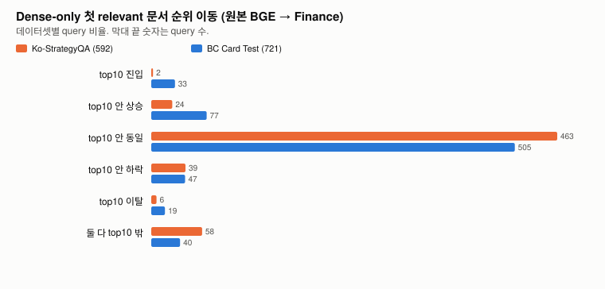
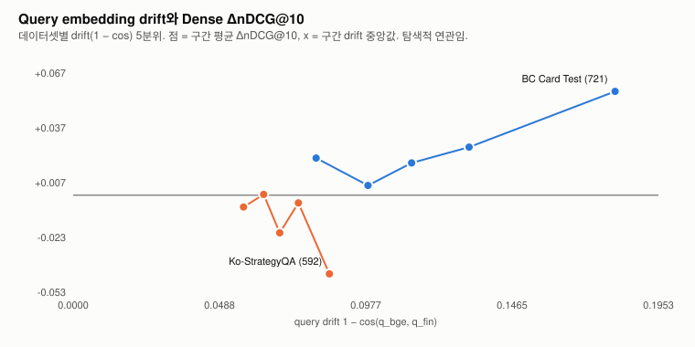

# Finance encoder의 Ko-StrategyQA 퇴보 탐색 분석

이 분석은 exploratory임. Ko-StrategyQA 결과를 이미 본 뒤 원인을 찾으려는 분석이라 여기 나온 연관은 가설 생성용이고 인과 증명이 아님. 사전 등록은 [`preregistration.md`](validation/2026-11-02/finance-strategyqa-analysis/preregistration.md)이고 분석 코드 작성 전에 커밋했음(`a1f9ee1`). 처음 분석(`19d9d14`, 이하 v1) 이후 리뷰에서 순위 parity와 해석을 다시 점검했고, 그 결과와 바뀐 부분을 이 문서와 [수정 내역](#수정-내역)에 남겼음. 재점검에서 새로 넣은 측정은 모두 사후 탐색임.

요약하면 Dense 손실과 Hybrid 손실은 query 단위로 강하게 겹쳐서, fusion이 독립 원인이라는 증거는 없었음. 사전 등록한 drift 가설과 "금융 쪽으로 끌려감" 가설은 지지되지 않았음. Finance는 두 데이터셋에서 query-문서 점수 전체를 아래로 평행 이동시켰고, 이 이동을 걷어내고 corpus 분포 대비로 보면 BC Card에서는 relevant 분리가 커졌고 StrategyQA에서는 작게 줄었음. StrategyQA 손실은 정답 passage가 여러 개인 query에서 컸고, lexical overlap이 낮은 query에서도 컸지만 후자는 소수의 큰 손실이 평균을 끌어내린 몫이 큼.

## 순위 parity

v1은 BC Card에서 features의 Dense top10이 PR #42 canonical 행과 BGE 39개, Finance 40개 query에서 다르다고 보고하고 FAISS–NumPy 경로 차이로 추정했음. 이번에 원인을 확인했음(`ranking-parity.json`).

같은 FP32 문서 vector(SHA는 `ranking-parity.json`에 기록), 같은 query vector, 같은 corpus 순서로 네 가지 순위를 비교했음. Canonical(PR #42 행, FAISS `IndexFlatIP`), 지금 다시 만든 FAISS, NumPy FP32 내적, NumPy FP64 내적이고 NumPy는 stable argsort(동점이면 corpus 앞 행 먼저)임.

- 다시 만든 FAISS 순위는 두 데이터셋, 두 encoder 모두 canonical과 전 query에서 같았음. 같은 query를 두 번 인코딩한 vector도 모두 bitwise로 같았음. 인코딩이나 FAISS 쪽 비결정성은 없었음.
- NumPy FP32와 FP64 순위는 전 query에서 같았음. FAISS 점수와 NumPy FP32 점수의 최대 절대오차는 3.6e-7임. 정밀도 차이는 원인이 아님.
- BC Card 문서 vector에는 bitwise로 같은 vector 그룹이 192개(문서 392개) 있음. StrategyQA에는 없음. 같은 vector는 어떤 query에서든 점수가 정확히 같음.
- 불일치 79건(BGE 39, Finance 40) 전부가 이런 동점 쌍 사이의 순서 차이였음. 점수 차는 79건 모두 0이고, 동점 외 원인으로 분류된 경우는 없음. FAISS는 79건 모두에서 corpus 뒤 행을 먼저 놓았고 NumPy stable argsort는 앞 행을 먼저 놓았음. 79건 중 70건은 두 문서 text도 같았고 9건은 text가 조금 달라도 vector가 같았음.
- Top10 집합 자체가 다른 경우는 BGE 2건, Finance 5건이고 나머지는 같은 집합 안의 순서 차이임. 집합 차이는 동점 그룹이 10위 경계에 걸친 경우임.
- nDCG@10이 바뀐 query는 BGE 9개, Finance 8개였음. 중복 문서 중 한쪽만 relevant로 라벨된 경우라 동점 순서가 지표를 바꿈.

최소 재현은 `tests/test_strategyqa_regression_evidence.py`의 `test_faiss_and_numpy_order_exact_ties_differently`임. 같은 vector 두 개를 넣으면 FAISS는 뒤 행, NumPy는 앞 행을 먼저 돌려줌.

이 동점 의존성은 PR #42 canonical 지표에도 있음. BC Card Dense 평균 nDCG@10은 NumPy 동점 순서로 바꾸면 BGE −.0006, Finance −.0015 달라지고, Finance − BGE 차이(+.0252)는 −.0008 움직임. 결론을 바꿀 크기는 아니지만 중복 문서 라벨이 지표에 끼어드는 한계로 남겨 둠. PR #42 결과는 바꾸지 않았음.

## 무엇을 어느 순위로 계산했나

- Canonical 행(PR #42) 그대로: ΔnDCG@10·ΔMRR@10·ΔRecall@10, W/T/L, Dense–Hybrid 상관(H4), query 특성별 손실, 사례 선택, 사후 same-source 집계.
- 새로 계산(v2): 첫 relevant 문서의 전체 corpus 순위, top10·top100 이웃 overlap. v2는 FAISS 전체 순서(k = corpus 크기)를 써서 canonical과 같은 동점 처리를 함. Features top10과 canonical의 불일치는 v2에서 0임(`features-parity.json`). 회귀 테스트 `test_rank_features_match_canonical_service_rows`가 이를 확인하고, v1 파일에 같은 검사를 돌리면 17건이 실패함.
- 점수 통계: 최고 relevant 점수, 최고 non-relevant 점수, margin, k번째 non-relevant와의 gap, corpus 평균·표준편차, z-점수, 중심과의 cos. NumPy FP32 점수를 씀. 최댓값과 k번째 값은 동점 순서와 무관함.

v1과 v2를 비교하면 StrategyQA는 모든 값이 같았음. BC Card는 첫 relevant 순위가 BGE 10개, Finance 11개 query에서 바뀌었지만 top10 진입·이탈·상승·하락 분류, overlap, margin, 상관 계수는 모두 그대로였음(`analysis.json`의 `v1_numpy_ties_vs_v2_canonical`). v1 결론 중 순위 parity 때문에 바뀌는 것은 없었음. v1 파일은 `*.v1-numpy-ties.*`로 그대로 보존했음.

## 순위 변화

| | StrategyQA (592) | BC Card (721) |
|---|---|---|
| Dense W/T/L (nDCG@10) | 55/438/99 | 110/545/66 |
| 서비스 Hybrid W/T/L | 53/442/97 | 91/569/61 |
| Fixed α=.84 W/T/L | 55/449/88 | 89/583/49 |
| Dense ΔnDCG@10 / ΔMRR@10 / ΔRecall@10 | −.0148 / −.0155 / −.0104 | +.0252 / +.0271 / +.0194 |



Dense에서 첫 relevant 문서의 전체 corpus 순위를 보면 StrategyQA는 top10 진입 2개, 이탈 6개, top10 안 상승 24개, 하락 39개, 그대로 463개였음. BC Card는 진입 33개, 이탈 19개, 상승 77개, 하락 47개였음. StrategyQA 손실은 대부분 top10 안에서 한두 칸 밀린 경우임.

Query별 ΔnDCG의 Dense–서비스 Hybrid Pearson은 .647, Dense–Fixed α는 .619임(BC Card .828, .766). Dense 손실 99개 중 서비스 Hybrid에서도 손실인 query가 74개, Fixed α에서는 66개임. Hybrid 손실은 Dense 손실과 크게 겹쳤고 BM25가 일부를 상쇄했음. 겹침이 크다는 것이지 Dense 변화가 원인이라는 증명은 아님.

## Embedding과 점수 분리

통계마다 범위를 적었음. "corpus"는 query마다 전체 문서에 대해 계산한 값, "top-K"는 상위 K개 이웃에 대한 값임. 두 encoder는 같은 문서 집합을 씀.

| 항목 (query 평균) | 범위 | StrategyQA | BC Card |
|---|---|---:|---:|
| Query drift 1 − cos(q_bge, q_fin) | query vector | .0706 | .1281 |
| 문서 점수의 BGE–Finance 상관 | corpus | .954 | .901 |
| Top10 / Top100 이웃 overlap | top-K | .783 / .781 | .653 / .645 |
| 점수 평균 변화 | corpus | −.0894 | −.1321 |
| 점수 표준편차 변화 | corpus | +.0018 | −.0008 |
| 최고 relevant 점수 변화 | corpus 최댓값 | −.0744 | −.0761 |
| 최고 non-relevant 점수 변화 | corpus 최댓값 | −.0717 | −.0939 |
| Top-1 gap 변화, 원점수 (relevant − 1위 non-relevant) | corpus 최댓값 | −.0027 | +.0177 |
| BC Card corpus 중심과의 cos 변화 | query vector | −.1616 | −.2021 |
| 자기 corpus 중심과의 cos 변화 | query vector | −.1637 | −.2021 |



H1(drift가 크면 손실이 큼)은 지지되지 않았음. Finance가 query를 바꾼 정도는 StrategyQA가 BC Card보다 오히려 작음. StrategyQA 안에서 drift와 Dense ΔnDCG의 Spearman은 −.098(p .017)로 약함. 5분위 그림에서는 drift가 가장 큰 구간의 손실이 가장 컸지만(평균 −.043), 나머지 구간 사이에서는 일관된 경향이 없었음.

H3(금융 쪽으로 끌림)도 지지되지 않았음. Finance는 두 데이터셋 모두에서 query를 BC Card corpus 중심에서 멀어지게 했고, 자기 corpus 중심에서도 비슷하게 멀어졌음. 이 이동량과 ΔnDCG의 상관은 .047(p .26)임.

H2(margin)는 v1에서 "StrategyQA margin이 평균적으로 그대로"라고 썼는데, 원점수 기준이라 오해를 부르는 표현이었음. 다시 보면 Finance의 점수 하락은 대부분 corpus 전체의 평행 이동임(평균 −.089 / −.132, 표준편차 변화는 ±.002 이내). 원점수 gap은 이 이동과 query마다 다른 분포 폭이 섞인 값이라 분리 변화를 직접 보여주지 못함. Query마다 corpus 점수를 z-점수로 바꿔 최고 relevant와 k번째 non-relevant의 차이(z-gap)를 보면 이렇게 나왔음(사후 측정).

| z-gap 변화 | StrategyQA 평균 / 중앙값 / 감소 비율 | BC Card 평균 / 중앙값 / 감소 비율 |
|---|---|---|
| k=1 | −.087σ / −.052σ / 55% | +.281σ / +.177σ / 30% |
| k=5 | −.076σ / −.033σ / 53% | +.532σ / +.467σ / 16% |
| k=10 | −.058σ / −.032σ / 53% | +.584σ / +.555σ / 15% |

Relevant가 1위 non-relevant보다 위에 있던 상태를 잃은 query와 얻은 query는 StrategyQA 22/12, BC Card 29/52였음. 5위 기준으로는 StrategyQA 10/0, BC Card 18/37임.

그래서 수정한 해석은 이렇게 됨. 평행 이동을 빼고 보면 BC Card에서는 relevant 분리가 뚜렷하게 커졌고, StrategyQA에서는 작지만 한쪽으로 줄었음. 평균 원점수 gap이 거의 그대로였던 것과 nDCG 하락은 모순이 아님. nDCG는 상위 몇 개 문서 사이의 국소 순서에 민감하고, 실제로 top-1 기준 손실 22건과 이득 12건의 차이가 손실의 상당 부분을 설명함. 다만 gap은 순위와 정의상 엮여 있어서 z-gap 변화와 ΔnDCG의 상관(StrategyQA k=1 ρ .303)을 독립 증거로 보면 안 됨.

정규화 전 norm은 측정하지 못했음. BGE-M3 SentenceTransformer pipeline에 `Normalize` 모듈이 있어서 `normalize_embeddings=False`로도 항상 1이 나왔음.

## Query 특성별 손실

Dense ΔnDCG@10 평균과 bootstrap 95% CI(seed 20261102, 5,000회). 구간 CI는 기술용이고 다중 비교 보정 없이 판정에 쓰지 않음.

| 특성 | StrategyQA | BC Card |
|---|---|---|
| Lexical overlap 하위 / 중간 / 상위 3분위 | −.027 [−.046, −.010] / −.013 / −.004 [−.013, +.006] | +.044 [+.016, +.073] / +.029 / +.002 [−.021, +.027] |
| 정답 passage 1개 / 2개 이상 | −.005 [−.019, +.008] (211) / −.020 [−.031, −.011] (381) | +.025 (721, 전부 1개) / 없음 |
| 길이 하위 / 중간 / 상위 3분위 | −.006 / −.021 / −.019 | +.006 / +.029 / +.043 |
| 금융 용어 있음 / 없음 | −.072 (4개) / −.014 (588) | +.023 (508) / +.031 (213) |

Lexical overlap 하위 3분위의 손실이 소수 outlier 때문인지 다시 봤음(사후 측정). StrategyQA 하위 3분위 199개의 평균 −.027 가운데 가장 큰 손실 5개가 합계 −2.75로 그룹 전체 합(약 −5.4)의 절반가량을 차지함. 5개를 빼면 평균 −.014, 10% 절사 평균 −.007, 중앙값은 0임. 대신 손실 비율 18.6% 대 개선 비율 9.6%로 손실 쪽으로 기운 정도는 상위 3분위(14.7% 대 11.7%)보다 큼. "손실이 하위 overlap에 몰렸다"는 v1 표현은 "하위 overlap 구간은 손실이 더 잦고, 평균 차이의 상당 부분은 큰 손실 몇 개에서 옴"으로 약하게 고쳤음. BC Card도 하위 3분위의 개선 평균 +.044에서 10% 절사 평균은 +.018로 줄어 비슷한 성격임.

정답 passage 수는 v1에서 다단계 근거의 proxy라고 불렀는데, 이 기준이 다단계 추론을 실제로 반영하는지 검증하지 않았음. 그래서 "정답 passage가 2개 이상인 query"로만 부름. 금융 용어 사전은 StrategyQA에서 4개만 걸려 정보가 없음. BC Card에서는 금융 용어가 없는 query에서도 개선이 있었음.

## 사례 검토와 사후 측정

StrategyQA Dense 손실 상위 15개와 개선 상위 5개를 직접 읽었음(`manual-review.json`, ID와 표시만 커밋). 손실 15개는 모두 금융과 무관한 일반 지식이었고 11개는 엔티티 사실 질문이었음. 4개는 짧거나 모호했고 2개는 "1번"처럼 앞 단계를 가리키는 분해 질문이었음. 개선 5개도 같은 유형 구성이라 이 표시만으로는 손실과 개선을 가를 수 없었음. Low overlap 표시는 처음에 눈으로 붙였다가 자동 규칙(하위 3분위)으로 다시 계산했고 한 건이 바뀌었음.

새 1위가 정답과 같은 출처(같은 Wikipedia 제목)인지는 사후에 셌음(`posthoc-same-source.json`). BGE 1위가 relevant였다가 Finance 1위가 non-relevant로 바뀐 22개 중 같은 출처는 2개뿐이라, 라벨 단위 문제로는 설명되지 않았음. BC Card에서는 같은 parent의 non-relevant가 1위에 온 경우가 없었음.

## BC Card와 StrategyQA 차이에 대해 말할 수 있는 것

절대 성능은 relevance 정의와 query 분포가 달라 직접 비교하지 않았고, 같은 분석을 양쪽에 적용한 상대적 패턴만 비교했음.

관찰한 것은 이렇게 됨. Finance는 두 데이터셋 모두에서 query-문서 점수 전체를 아래로 평행 이동시킴. 분포 대비 relevant 분리는 BC Card에서 커지고 StrategyQA에서 작게 줄었음. Finance 효과의 크기는 두 데이터셋 모두 lexical overlap이 낮은 query에서 컸고 방향만 반대였음.

관찰하지 못한 것도 있음. StrategyQA query가 더 많이 변했다거나 금융 방향으로 끌려갔다는 증거는 없었고, 라벨 단위 문제로도 설명되지 않았음.

추론은 검증하지 않았음. 학습 목표가 BC Card positive와 hard negative를 가르는 쪽이라 그 분리가 학습 분포 안에서는 늘고, 금융 밖 엔티티·일반 지식 query에서는 근접 경쟁 passage 사이의 순서를 약하게 흔들었을 가능성이 있음. 이 설명을 지지하는 직접 증거는 아직 없음.

## 아직 검증되지 않은 가설

- 손실이 학습 데이터 분포 밖 query에서 생기는지. BC Card train query와의 최근접 거리(또는 밀도)와 StrategyQA 손실의 관계를 봐야 함. 이번 분석에서는 train query vector를 보지 않았음.
- 점수 평행 이동이 특정 공통 성분 제거인지. 차이 vector(q_fin − q_bge)의 query 간 일관성과 주성분을 봐야 함.
- 학습 step에 따라 StrategyQA 분리 감소가 커지는지. 기존 checkpoint(step 0~2048) 평가만으로 가능하고 재학습은 필요 없음.
- Seed42에서도 같은 패턴이 나오는지.
- 다른 일반 도메인 데이터셋에서 z-gap 패턴이 재현되는지. Ko-MIRACL dev는 50개라 검정력이 부족함.
- 중복 문서 라벨이 canonical 지표에 끼는 영향을 평가 단계에서 없앨지(예: 동일 vector 문서 묶기). 지표 정의를 바꾸는 일이라 별도 결정이 필요함.

모두 별도 사전 등록 후 검증해야 함. 개선 실험(재학습, α 변경, threshold 조정)은 하지 않았음.

## 수정 내역

| 항목 | v1 (`19d9d14`) | 수정 | 이유 |
|---|---|---|---|
| BC Card top10 불일치 39/40 | FAISS–NumPy 경로 차이로 추정 | 중복 vector 동점 순서 차이로 확인. 동점 외 원인 0건 | `ranking-parity.json` |
| 순위 특성 | NumPy stable argsort | FAISS 전체 순서(canonical과 같음) | 동점 처리를 canonical에 맞춤. 바뀐 값은 BC Card 첫 relevant 순위 10/11개, 분류와 결론은 그대로 |
| StrategyQA margin | "평균적으로 그대로" | 원점수 평균 gap은 거의 그대로이나 z 기준 분리는 작게 감소 | 평행 이동과 분리를 구분 |
| Lexical overlap 하위 손실 | "몰렸다" | 손실이 더 잦고, 평균 차이의 상당 부분은 큰 손실 몇 개 | outlier 점검 |
| 정답 2개 이상 | 다단계 근거 proxy | 정답 passage 수로만 기술 | proxy 타당성 미검증 |
| Dense와 Hybrid 관계 | "손실은 Dense에서 생겼고" | 손실이 query 단위로 겹침, 인과는 아님 | 상관만 관찰 |

v1 수치 파일은 `analysis.v1-numpy-ties.json`, `per-query-summary.v1-numpy-ties.jsonl`, `features-parity.v1-numpy-ties.json`, 그림 두 개의 `*.v1-numpy-ties.svg`로 남겨 뒀음.

## 재현

```bash
COMMON="--data-dir $FINANCE_DATA --cache-dir $FINANCE_CACHE --external-cache artifacts/score-fusion-cache"
MODEL="--base-model $FINANCE_MODEL --checkpoint $REPRO_RUN/train-seed43/selected-last-block.pt"
run() { uv run --locked --extra sparse --extra dense python -m scripts.analyze_strategyqa_regression "$@"; }
run features $COMMON $MODEL        # GPU, v2 per-query-summary.jsonl, features-parity.json
run ranking-parity $COMMON $MODEL  # GPU, ranking-parity.json
run posthoc $COMMON                # 로컬 qrels, posthoc-same-source.json
run cases $COMMON                  # 수동 검토용 원문을 stdout에만 출력
run analyze                        # 커밋된 파일만 사용, analysis.json과 그림
run check
uv run --locked --extra sparse --extra dense pytest -q tests/test_strategyqa_regression_evidence.py
```

`check`는 `analysis.json`과 그림을 다시 계산해 비교하고, 로컬 데이터가 필요한 `posthoc-same-source.json`, `features-parity.json`, `ranking-parity.json`, v1 파일은 해시로 확인함. CI는 `fusion-tests` job에서 이 테스트를 skip 없이 돌림. Query 원문, vector, 모델은 커밋하지 않았음.
