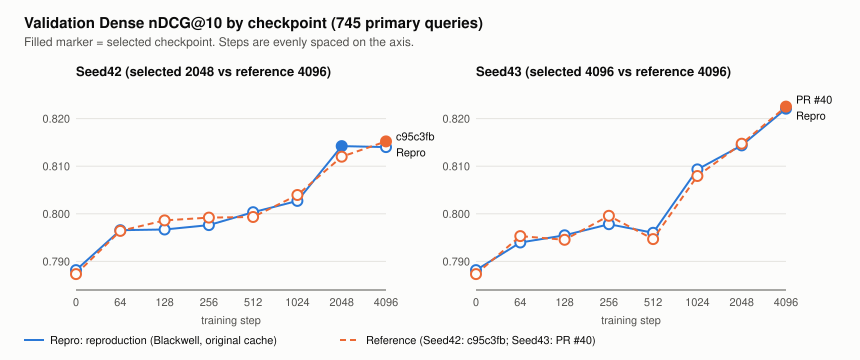
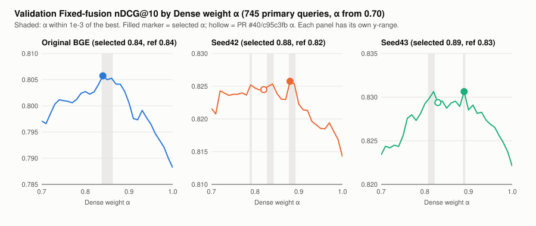

# BC Card Finance query encoder: two-seed reproduction on Blackwell

**Partial reproduction.**
- PR #40's exact inputs were used.
- Seed43's training curve and checkpoint choice reproduce numerically.
- Seed42's checkpoint choice and both adapted encoders' Validation-selected α changed.
- Test nDCG@10 reproduces within the pre-registered tolerances.
- Both seeds outperform the matched original BGE baseline.

The training pipeline, the protocol and PR #40's evidence are unchanged. This document adds an independent run on different hardware.

Evidence: [`docs/validation/2026-11-02/finance-repro-blackwell/`](validation/2026-11-02/finance-repro-blackwell/).
Reference: PR #40 ([`finance-retrain/`](validation/2026-11-02/finance-retrain/)) and, for Seed42 only, commit `c95c3fb` (`docs/validation/2026-11-01/finance/`).

## What was run
- **Code:** PR #40 head `b6f8649a`, a clean detached worktree. The six query-encoder sources are byte-identical to the historical training record.
- **Inputs:**
  - BC Card manifest `b6bb7822…` (36,281 chunks; train 43,394 → 43,150 eligible after excluding 244; primary Validation 745 / Test 721).
  - BGE-M3 `5617a9f6` (10 pinned file hashes).
  - The **original** WSL2 vector cache, from release [`finance-encoder-inputs-v1`](https://github.com/shannonlee-dev/hybrid-document-search/releases/tag/finance-encoder-inputs-v1) (archive `62138a1c…`). All five pinned hashes match.
- **Hardware and software:** 2× RTX PRO 6000 Blackwell Max-Q (driver 610.57.04), AMD EPYC 9554, Linux 6.8. Torch 2.14.1+cu130, transformers 5.18.0, sentence-transformers 6.1.0, numpy 2.5.3 (`uv --locked`). Seed42 ran on GPU0 and Seed43 on GPU1, concurrently.
- **Reference environment:** RTX 4060 under WSL2, with the same package versions.
- **Protocol:** unchanged.
  - Training: 4,096 steps, batch 16, last 4 blocks (50,384,896 parameters), AdamW 2e-5 with weight decay .01, τ .05, tether 1, 8 hard negatives, clipping 1, 128/512 tokens, FP32 parameters with BF16 autocast.
  - Checkpoints {0, 64, …, 4096} are selected on Validation Dense binary nDCG@10, and the earliest step wins ties.
  - Fixed fusion: α ∈ 0:.01:1 on Validation; the lowest α and then the baseline win ties; a shared α = .84 is also evaluated.
- **Order:** pre-registration → training → score cache → BF16 baseline → `select` → **freeze** → `checkpoint` (adapted Test vectors) → `evaluate` → `export` → `verify`.
  - This order is stricter than the PR #40 handoff, which ran `checkpoint` before `select`. The algorithm is unchanged.
  - The baseline Test vectors this order produced are bitwise identical to those from `checkpoint`.
- **Loss logging:** a local launcher called the unchanged training CLI and also appended each `progress.json` write to a log. It observes only.

## Reproduction levels (criteria in [`preregistration.md`](validation/2026-11-02/finance-repro-blackwell/preregistration.md), frozen before training)
| Level | Result |
|---|---|
| Exact-input reproduction | **Yes.** Dataset, model and cache hashes match, and the Dense/BM25 score cache (computed on CPU in FP64) is bitwise identical to PR #40's. |
| Bitwise training reproduction | **No.** Neither checkpoint hash matches. |
| A. Numerical training reproduction | **Seed43 yes.** Max \|Δ\| .0018 (tolerance .005), and step 4096 is selected again. **Seed42 no.** The curve is within tolerance (max \|Δ\| .0022), but step 2048 is selected instead of 4096. |
| B. Model-selection reproduction | **No.** The final encoder (seed43) and the baseline α (.84) match, but the adapted α values differ: seed42 .88 vs .82, seed43 .89 vs .83. |
| C. Retrieval-performance reproduction | **Yes, within tolerance.** Baseline max \|Δ\| .0014 (tolerance .002); Seed43 \|Δ nDCG@10\| ≤ .0022 (tolerance .005). |
| D. Beats the matched baseline | **Yes.** Seed43 gain +.0211, 95% bootstrap CI [+.0072, +.0355]. Every seed and policy combination is positive. |

## Training curves


| Step | Seed42 | ref (c95c3fb) | Δ | Seed43 | ref (PR #40) | Δ |
|---:|---:|---:|---:|---:|---:|---:|
| 0 | .788180 | .787339 | +.000841 | .788180 | .787339 | +.000841 |
| 64 | .796553 | .796406 | +.000147 | .793974 | .795320 | −.001346 |
| 128 | .796713 | .798620 | −.001907 | .795478 | .794551 | +.000927 |
| 256 | .797622 | .799214 | −.001592 | .797824 | .799577 | −.001752 |
| 512 | .800336 | .799333 | +.001003 | .796014 | .794696 | +.001317 |
| 1024 | .802714 | .803959 | −.001245 | .809317 | .807949 | +.001369 |
| 2048 | **.814211** | .811984 | +.002227 | .814365 | .814731 | −.000366 |
| 4096 | .814012 | **.815200** | −.001187 | **.822078** | **.822511** | −.000433 |

Bold marks each run's selected step.
- **Seed42:** step 2048 beat step 4096 by **.000199**; in the reference, 4096 led by .003216.
- **Seed43:** step 4096 led its runner-up by .0077.
- **Checkpoint hashes:** Seed42 `c78c8db1…` (reference `361e09ee…`), Seed43 `fbbd5ed0…` (reference `d36f5c66…`).
- **Loss:** [`training-loss.json`](validation/2026-11-02/finance-repro-blackwell/training-loss.json) holds the single-batch loss sampled every 64 steps.

## Validation α stability (selections unchanged)


| Encoder | Selected α (ref) | Best Validation nDCG@10 | Gap at ref α | α within 1e-4 | α within 1e-3 | α within 5e-3 |
|---|---|---:|---:|---|---|---|
| Original BGE | .84 (.84) | .805739 | 0 | {.84} | .84–.86 | .74–.76, .78–.89 |
| Seed42 | .88 (.82) | .825757 | .00128 | {.88} | {.79}, .83–.84, .88–.89 | .69–.92 |
| Seed43 | .89 (.83) | .830633 | .00125 | {.82, .89} | .81–.82, {.89} | .76–.96 |

How material the changes are:
- **The curves are flat and jagged near their optimum.** Seed43's curve has two near-equal peaks: .830633 at α .89 and .830630 at .82, 3×10⁻⁶ apart.
- **The α changes are within noise.** A paired bootstrap over the 745 Validation queries puts the advantage of the selected α over the reference α at +.0012 (95% CI [−.0044, +.0069]) for Seed43 and +.0013 ([−.0047, +.0073]) for Seed42.
- **Most queries don't move.** 683 and 681 queries respectively are unaffected by the change.

So the α changes are mostly a consequence of an argmax over a flat, noisy objective, not evidence of a materially different optimum. They are still reported as model-selection non-reproduction, and the frozen α values were not changed.

## Test results (721 primary queries, frozen selections)
| Method | α | P@1 | Recall@10 | MRR@10 | nDCG@10 | Δ nDCG@10 vs PR #40 |
|---|---:|---:|---:|---:|---:|---:|
| Original BGE + Fixed (shared = selected) | .84 | .678225 | .891817 | .758435 | .791242 | +.000310 |
| Seed42 + Fixed, shared | .84 | .692094 | .920943 | .775761 | .811276 | n/a |
| Seed42 + Fixed, Validation-selected | .88 | .683773 | .916782 | .770681 | .806579 | n/a |
| Seed43 + Fixed, shared | .84 | .692094 | .919556 | .777347 | .812386 | −.002137 |
| **Seed43 + Fixed, Validation-selected (final)** | .89 | .693481 | .918169 | .779044 | .813412 | −.001538 (ref α .83) |

The full-precision values and all four metric differences are in [`analysis.json`](validation/2026-11-02/finance-repro-blackwell/analysis.json) under `test`.
PR #40 has no Seed42 Test result.
- **Baseline:** P@1 +.001387, Recall −.001387, MRR +.000786.
- **Seed43 at α .84:** P@1 −.001387, Recall −.002774, MRR −.001940.

**Paired bootstrap** (post-hoc uncertainty only; seed 20261102; 20,000 resamples; percentile CIs; not a new held-out experiment):

| nDCG@10 difference | Mean | 95% CI | W/T/L |
|---|---:|---|---|
| Seed43 α .84 − baseline α .84 (primary) | +.021144 | [+.007176, +.035484] | 87/585/49 |
| Seed43 selected α .89 − baseline | +.022169 | [+.007807, +.036945] | 89/584/48 |
| Seed42 α .84 − baseline | +.020033 | [+.007120, +.033529] | 78/596/47 |
| Seed42 selected α .88 − baseline | +.015336 | [+.002437, +.028728] | 80/589/52 |
| PR #40 Seed43 α .84 − PR #40 baseline (same method) | +.023591 | [+.009933, +.037822] | 89/585/47 |
| Reproduced − PR #40 Seed43, α .84 (cross-run) | −.002137 | [−.006354, +.001448] | 13/690/18 |

The reproduced gain is smaller than PR #40's by .0024, but the cross-run difference CI includes zero.

## What the evidence does and does not show about the differences
- **Shown:**
  - The code, package versions and every input byte are identical.
  - The CPU FP64 score cache reproduces bitwise.
  - On the reference machine, Seed43 trained twice (`c95c3fb` and the PR #40 retrain, with different timings) produced the same checkpoint SHA. So the pipeline is deterministic within that environment.
- **Not isolated:** the GPU model, driver, CUDA kernel selection, host OS (WSL2 vs native Linux) and concurrent two-GPU execution all differ together from the reference. The differences are consistent with GPU-side floating-point behavior, but this run does not attribute them to GPU architecture alone.
- **Observed sensitivity:** BF16 encoding of the unmodified model already changes step-0 Validation by +.00084 and alters 111 of the 721 baseline Test top-10 lists, though only 5 change nDCG@10. Selection margins of 2×10⁻⁴ (checkpoint) and 3×10⁻⁶ (α) are far below this level.

## Limitations
- **Test text in deduplication:** the original exclusion rule uses Validation **and Test** query text. 150 of the 244 excluded training rows are Test-derived: 126 match Test only and 24 match both splits. The rule was kept unchanged for reproduction.
- **Prior Test exposure:** the official Validation and Test splits have been used in earlier exploration, so this is not an independent held-out test.
- **Test qrels access:**
  - `prepare` loads Test qrels through the shared loader but discards them.
  - `checkpoint` computes Dense-only Test metrics, which were not used. It ran after the selection freeze.
- **False negatives:** hard negatives are mined from frozen baseline vectors with only same-parent masking, so unlabeled relevant chunks can become negatives.
- **Selection metric vs reported metrics:** selection uses binary nDCG@10, while Test reports four metrics.
- **Precision:** the matched BF16 baseline is not the FP32 cached baseline (.791013) or Main canonical Fixed (.794015, a different fusion formula).
- **Seed42 reference:** the `c95c3fb` record has no training commit or source hashes, and its α was selected against an FP32 baseline.
- **`run_id`:** the exported `run_id` is `"replay"` because the CLI derives it from the output directory name. It is hash-bound, so it was left as is.

## Errata against the local run report
The audit found these statements in the local `REPORT.md` unsupported; they are corrected here:
- **α .81–.89 within .001.** It said all α .81–.89 (Seed43) and .79–.89 (Seed42) were within .001 of the best. The near-optimal sets are non-contiguous; see the table above.
- **Step-0 cause.** It said the step-0 difference came "purely from BF16 encoding on a different GPU". The hardware and software stack differ jointly; see above.
- **Bitwise divergence timing.** It said training "diverges bitwise within the first steps". This was not measured.

## Verify
```bash
# Integrity of committed evidence, analysis and figures (no data needed)
uv run --locked python scripts/analyze_finance_reproduction.py check
uv run --locked pytest -q tests/dense/test_finance_reproduction_evidence.py

# Recompute every per-query metric from rankings with the official BC Card data
uv run --locked --extra sparse --extra dense python -m scripts.evaluate_query_encoder verify \
  --data-dir "$FINANCE_DATA" --output-dir docs/validation/2026-11-02/finance-repro-blackwell

# Original vector cache
gh release download finance-encoder-inputs-v1 -R shannonlee-dev/hybrid-document-search -p finance-vector-cache.tar.gz
echo "62138a1c381771831d5999758dc27d81cc5a822e7384988bd7159c494824728d  finance-vector-cache.tar.gz" | sha256sum -c
```
To rerun the experiment, follow the [PR #40 handoff](BCCARD_QUERY_ENCODER_TRAINING.md), with `select` run on the `train-seed*` directories and frozen before `checkpoint`.
`analyze_finance_reproduction.py export-evidence --run-dir <run>` rebuilds this directory from a local run.

| File | Contents |
|---|---|
| `frozen.json`, `protocol.json`, `per-query.jsonl`, `per-query-manifest.json` | `export` output, byte-identical: 3 encoders × 2 α policies × 721 = 4,326 rows of IDs, metrics and top-10 document IDs (no query text) |
| `preregistration.md`, `selection-freeze.json` | Tolerances frozen before training; selection frozen before any Test vector |
| `validation-alpha-curves.json` | Mean Validation nDCG@10 per α, plus per-query values at the selected, reference and shared α |
| `training-loss.json`, `environment.json` | Sampled loss; GPUs, driver, packages, source hashes |
| `analysis.json`, `*.svg`, `MANIFEST.sha256` | Bootstrap, α stability, curves, Test deltas; figures; file hashes |

Checkpoints, vectors, score matrices, model weights and caches are not committed.
