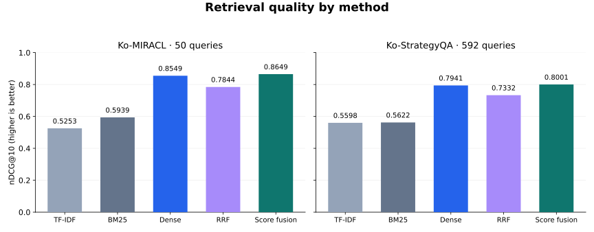
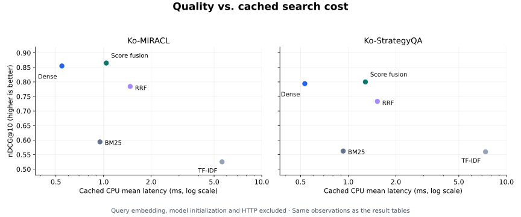

# 검색 벤치마크 결과

최종 평가: 2026-10-16 · 평가 담당: 반가희 (Asia/Seoul)

## 핵심 결론

이 평가는 한국어 문서 검색에서 TF-IDF·BM25·Dense·RRF·Score fusion의 품질과 검색 비용을 비교한다.
**최종 방식은 Dense를 중심으로 BM25 점수를 더하는 Score fusion이다.** 두 데이터셋에서
Dense와 기존 RRF보다 Recall@10·MRR@10·nDCG@10이 높았다는 관측 결과가 선택의 근거다.

Dense 대비 nDCG@10의 절대 개선폭은 Ko-MIRACL에서 **+0.0100**, Ko-StrategyQA에서 **+0.0060**이다.
그에 따른 캐시 기반 CPU 검색·결합 평균 시간 증가는 각각 **약 0.50ms**, **약 0.75ms**다.
질의 임베딩을 제외한 검색 단계에서 이 추가 비용으로 품질 개선을 얻었다.
다만 StrategyQA Recall@5는 소폭 낮아졌고, 품질 차이의 통계적 유의성은 검증하지 않았다.

**주 표와 그래프의 시간은 캐시 벡터 기반 CPU 검색·결합 시간이다.**
질의 임베딩·모델 초기화·HTTP를 포함한 서비스 응답시간과 구분한다.
추론을 포함한 기존 GPU 측정은 별도 절에 제시한다.

## 평가 조건과 지표

Ko-MIRACL은 문서 10,000개·dev 질의 50개, Ko-StrategyQA는 문서 9,251개·dev 질의 592개를 사용했다.
동일한 고정 입력과 BGE-M3 캐시 벡터로 각 방식을 평가했다.
Python 3.12.15 / macOS 26.6.2 / arm64에서 CPU FAISS·BLAS 스레드를 2개로 고정했다.
전체 dev 질의를 1회 warm-up한 뒤 시간 측정을 5회 반복했다.
**5회 반복은 시간 측정의 반복이며, 독립적인 품질 평가 5회를 의미하지 않는다.**

TF-IDF와 BM25는 어휘 일치 기반 검색, Dense는 BGE-M3 벡터 유사도 기반 검색이다.
기존 RRF는 BM25와 Dense의 순위를 결합한다. 최종 Score fusion은 Dense 점수에
정규화한 BM25 점수를 최대 0.05까지 더한다. α=0.05는 기존 Train100 선정값을 고정했다.

- **Recall@k:** 정답 문서 중 상위 k개 검색 결과에 포함된 비율. 높을수록 좋다.
- **MRR@10:** 상위 10개 안에서 첫 정답 순위의 역수를 평균한 값. 정답이 앞에 올수록 높다.
- **nDCG@10:** 상위 10개의 정답 배치를 이상적인 순위와 비교한 값. 높을수록 좋다.
- **Mean / P95:** 평균 검색시간 / 시간 표본의 95백분위수. 낮을수록 좋다.

품질은 relevance > 0을 정답으로 처리한 binary gain과 질의별 동일 가중치 평균을 사용한다.
표의 굵은 값은 각 데이터셋·측정 범위에서 품질 최댓값 또는 시간 최솟값이다.
표시는 품질 소수점 4자리·시간 3자리로 줄였고, 비교와 그래프는 반올림 전 값을 사용했다.

## 품질과 검색 비용 비교

두 데이터셋 모두 Score fusion의 nDCG@10이 가장 높고 Dense가 그다음이다.
막대 축을 0부터 표시해 작은 차이를 과장하지 않았다. 데이터셋 간 절대 점수보다 각 데이터셋 안의 방식 차이를 비교한다.

각 패널에서 왼쪽 위일수록 검색시간이 짧고 품질이 높다. Dense는 가장 빠르고,
Score fusion은 검색시간을 추가로 사용해 품질을 높인다. 작은 시간 차이를 읽기 위해 가로축은 로그 눈금이다.
점은 관측 평균이며 신뢰구간이나 통계적 유의성을 나타내지 않는다.

## Ko-MIRACL Dev50

문서 10,000개 · 질의 50개 · 방법당 250개 시간 샘플.

| 방식 | Recall@5 | Recall@10 | MRR@10 | nDCG@10 | CPU Mean ms | CPU P95 ms |
|---|---:|---:|---:|---:|---:|---:|
| TF-IDF | 0.5767 | 0.7227 | 0.4952 | 0.5253 | 5.616 | 6.511 |
| BM25 | 0.5877 | 0.7507 | 0.5979 | 0.5939 | 0.949 | 1.095 |
| Dense (BGE-M3) | 0.8137 | 0.9583 | 0.8610 | 0.8549 | **0.545** | **0.626** |
| 기존 RRF | 0.7653 | 0.9277 | 0.7906 | 0.7844 | 1.474 | 1.661 |
| 최종 Score fusion | **0.8153** | **0.9683** | **0.8812** | **0.8649** | 1.041 | 1.159 |

원시 결과는 로컬 artifacts/final-evaluation/20261016/miracl10k/에 보존한다.
results.json SHA-256: 097f049dd7d2caa5a39335a3fa0340ed45e2642062826b8ac13b7ca0d2720e8c.
## Ko-StrategyQA dev

문서 9,251개 · 질의 592개 · 방법당 2,960개 시간 샘플.

| 방식 | Recall@5 | Recall@10 | MRR@10 | nDCG@10 | CPU Mean ms | CPU P95 ms |
|---|---:|---:|---:|---:|---:|---:|
| TF-IDF | 0.6052 | 0.6825 | 0.5753 | 0.5598 | 7.380 | 8.228 |
| BM25 | 0.5978 | 0.6668 | 0.5831 | 0.5622 | 0.930 | 1.029 |
| Dense (BGE-M3) | **0.8135** | 0.8520 | 0.8112 | 0.7941 | **0.531** | **0.694** |
| 기존 RRF | 0.7708 | 0.8401 | 0.7393 | 0.7332 | 1.528 | 1.736 |
| 최종 Score fusion | 0.8133 | **0.8586** | **0.8166** | **0.8001** | 1.284 | 1.428 |

원시 결과는 로컬 artifacts/final-evaluation/20261016/strategyqa/에 보존한다.
results.json SHA-256: 887b39ae2b4a00ff55fe7ed6f9b2e7b6d15e92bf088b11e860921bced9abb2e6.
## 채택 근거와 해석

Score fusion은 기존 RRF보다 두 데이터셋의 Recall@10·MRR@10·nDCG@10이 높았고,
캐시 기반 평균 검색시간도 짧았다. Dense와 비교하면 품질과 비용의 교환이 있다.
MIRACL nDCG@10은 0.8549→0.8649, StrategyQA는 0.7941→0.8001로 개선됐지만,
StrategyQA Recall@5는 0.8135→0.8133으로 소폭 낮아졌다.
따라서 상위 10개 결과의 품질을 우선한 프로젝트 선택이며 모든 지표에서의 우월성을 뜻하지 않는다.

기존 RRF는 두 검색기의 Top-10에 함께 나타난 문서를 우선해 강한 Dense 결과를 밀어낼 수 있다.
Score fusion은 Dense 점수 차이를 유지하면서 BM25의 영향을 제한한다.
다만 두 방식은 가중치와 후보 범위도 달라 이번 차이를 점수 결합 방식만의 효과로 단정할 수 없다.
PR #18의 가중 RRF 대조에서도 Dense 중심 가중치만으로 기존 RRF 손실이 해소됐다.
벡터 보정은 StrategyQA 성능 하락을 근거로 최종 설정에서 제외했다.

## 추론 포함 검색 시간: 기존 측정 기록

다음은 **이상헌이 PR #18에 보존한 기존 MIRACL 측정**이다. 이번 Mac 재현값이 아니다.
WSL2 / Intel i3-12100F / RTX 4060 / BGE-M3 FP32 / CPU 2 threads.
query embedding 시작부터 Top-10 반환까지, 방식별 warm-up 10회 후 Dev50 × 10회, 500표본.
모델·인덱스 초기화, HTTP·직렬화·동시 부하는 제외한다.

| 방식 | Query-time Mean ms | Query-time P95 ms |
|---|---:|---:|
| Dense | 22.004 | 31.190 |
| 기존 RRF | 24.117 | 35.033 |
| Score fusion | **21.191** | **30.747** |

출처: [#18의 결과 문서](https://github.com/shannonlee-dev/hybrid-document-search/blob/081c7abb031153da80db71c4362938be6e22a5f1/docs/SCORE_FUSION_RESULTS.md).
StrategyQA의 동일 GPU 추론 포함 시간은 이번 평가에서 새로 측정하지 않았다.
CPU 캐시 비교와 위 GPU 표는 서로 다른 질의 반복·warm-up 조건이며 합치지 않는다.
## 한계와 적용 범위

MIRACL 결과는 관련 문서를 포함한 10k subset의 성능이며 전체 공식 MIRACL 성능이 아니다.
두 데이터셋의 질의 수가 다르고 과거 실험에 노출된 dev 데이터의 확인 평가이므로,
신규 독립 검증·일반화·통계적 우월성을 주장하지 않는다.

방법 순서는 TF-IDF → BM25 → Dense → RRF → Score fusion으로 고정했다.
단일 세션 순차 실행이므로 실행 순서·열 상태·시스템 부하에 따른 시간 변동을 제거하지 못했다.
캐시 기반 시간에는 질의 임베딩이 빠져 있어 Dense의 실제 서비스 비용을 나타내지 않는다.
본 벤치마크는 동시 부하·장시간 운영 안정성을 평가하지 않는다.
서비스 검증 범위는 [SEARCH_SERVICE.md](SEARCH_SERVICE.md)를 참조한다.

## 실행과 검증 근거

- 기준 main: 7f3333627fc2ba947f768ba5e63253ac1fa84837.
- 의존 구현: PR #18, 081c7abb031153da80db71c4362938be6e22a5f1.
- main에서 분기한 평가 코드와 #18을 임시 통합한 복사본에서 실행했다.
  의존 PR 코드를 본인 커밋으로 복사하거나 main에 병합하지 않았다.
- Python 3.12.15 / macOS 26.6.2 / arm64, CPU FAISS·BLAS 2 threads.
- BGE-M3 revision: 5617a9f61b028005a4858fdac845db406aefb181; FP32·L2 정규화 캐시.
- Top-10, 전체 dev 질의 warm-up 1 pass 후 측정 5 passes, 준비·검증·저장은 타이머 밖이다.
- 방법 순서는 TF-IDF → BM25 → Dense → RRF → score fusion으로 고정했다.
  단일 세션 순차 실행이며 순서·열 상태·시스템 부하에 따른 변동을 제거한 실험은 아니다.
- 지표는 relevance > 0의 binary gain과 질의별 동일 가중치 평균, P95는 선형 보간이다.
- 고정 cache 8개 입력 파일의 SHA-256을 확인했다. MIRACL의 corpus·Train100/Dev50
  질의·qrels가 기존 로컬 준비 데이터와 정확히 같음을 별도로 대조했다.
- 저장된 3,210개 방법별 질의 결과의 지표와 16,050개 latency 샘플의 mean/P95를
  표준 라이브러리로 독립 재계산하고 CSV와 대조했다. 모든 실행 소스 해시도 확인했다.
- Dense/RRF/score fusion의 품질 지표는 #18의 두 데이터셋 보존 결과와 허용오차 1e-12 이내다.
- 당시 의존 구현을 포함한 전체 오프라인 테스트 769 passed; 기본 feature branch는
  678 passed / 4 skipped (#18이 필요한 실제 캐시·fusion fixture 테스트).
- 두 소스 구성의 Ruff lint·format을 확인했다. 모델 가중치를 다운로드하거나 GPU 추론을 재실행하지 않았다.
재현 명령, 지표 규칙과 로컬 산출물 형식은 [FINAL_EVALUATION.md](FINAL_EVALUATION.md)를 따른다.

## 평가 이력

최신 비교와 해석은 이 문서에 갱신하고, 이전 실험의 수치·조건·출처는 날짜별 기록으로 보존한다.

| 평가일 | 기록 | 주요 내용 |
|---|---|---|
| 2026-10-08 | [RRF baseline 비교 기록](benchmarks/2026-10-08-rrf-baseline.md) | Ko-MIRACL 네 방식 비교, query embedding 포함 검색 시간 |
| 2026-10-16 | [현재 평가 결과](#검색-벤치마크-결과) | Score fusion 추가, 두 데이터셋·다섯 방식 비교, 주 표는 캐시 벡터 기반 CPU 시간 |

두 실험은 측정 환경과 시간 측정 범위가 다르므로 latency를 직접 비교하지 않는다.
