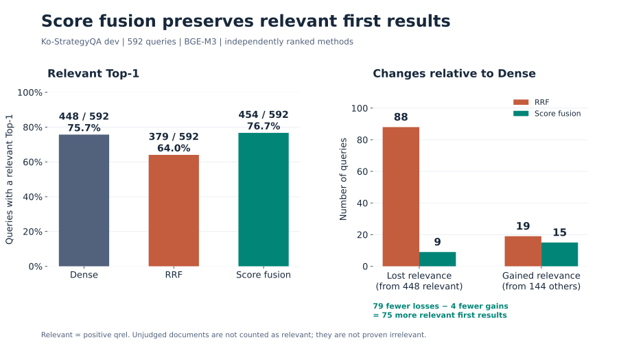
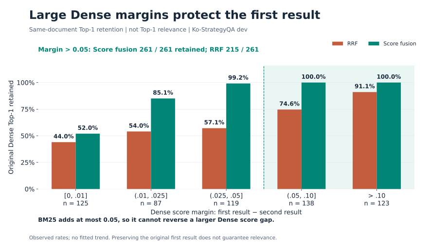
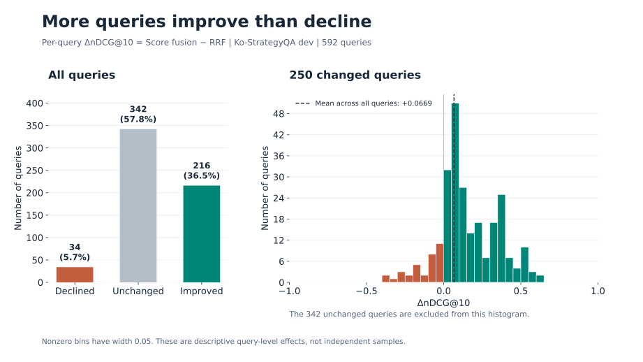

# RRF와 Score Fusion의 성능 차이 분석: Dense 점수 보존과 가중치의 영향

## 초록

**본 실험의 동일 가중치·Top-10 RRF 설정에서는 두 검색기의 공통 후보가 우선되면서 Dense가 높은 점수를 부여한 관련 문서가 밀려나는 현상이 관찰됐다. Score fusion은 Dense의 큰 점수 차이를 보존하면서 BM25가 작은 점수 차이만 교정하도록 해 이러한 손실을 줄였다.** Ko-StrategyQA의 질의별 순위 변화와 후보 범위 대조로 이 설명을 검토하고, 별도 선정용 질의에서 고정한 가중 RRF는 Dense 단독과 같은 순위를 회복했다. 따라서 관측된 개선에는 Dense 중심 가중치의 효과가 크며, score fusion 자체의 추가 우위는 제한적으로 해석해야 한다.

## 1. 평가 설계

주 분석은 Ko-StrategyQA dev의 전체 9,251문서와 592질의를 대상으로 한다. Dense는 `title + "\n" + text`를 BGE-M3로 인코딩한 FP32·L2 정규화 벡터의 내적을 사용한다. BM25는 `char_wb` 문자 2–4gram, Lucene 방식, `k1=1.5`, `b=0.75`이다. 벡터 보정은 적용하지 않았다.

| 방법 | 후보 범위 | 결합 규칙 |
|---|---|---|
| Dense | 전체 corpus | 정규화 벡터 내적 |
| 기존 RRF | 각 검색기의 상위 10개 합집합 | 동일 가중치, 순위 상수 60 |
| 전체 후보 RRF | Dense 전체 문서와 BM25 양의 점수 문서 | 기존 RRF와 동일한 결합 규칙 |
| 가중 RRF | Top-10 / 전체 후보 각각 평가 | Dense 가중치 1, BM25 가중치는 Train100에서 선정 |
| Score fusion | 전체 corpus | Dense 점수 + 0.05 × 최대값 정규화 BM25 |

가중치 0.05는 평가 중 고정했다. 선정 근거는 [결과 보고서](SCORE_FUSION_RESULTS.md#최종-설정-선정-근거)에 있다. 본 분석은 저장된 평가 결과에 대한 사후 진단이며, 새로운 미노출 평가로 취급하지 않는다.

주 지표는 양의 qrel을 관련 문서로 처리한 binary nDCG@10의 질의별 산술 평균이다. Recall@10은 관련 문서의 검색 범위를, Top-1 관련성은 첫 번째 결과가 양의 qrel 문서인지 평가한다. 미판정 문서는 지표 계산에서 관련 문서로 세지 않지만, 의미적 비관련이 확인된 문서와 동일시하지 않는다.

## 2. 두 결합 방식의 수학적 차이

### 2.1. Top-10 RRF의 중복 우선 성질

질의 $q$, 문서 $d$, 검색기 $j\in\{D,B\}$에 대해 $L_j^{10}(q)$를 상위 10개 목록, $r_j(q,d)$를 해당 목록의 순위라 하면 기존 RRF는 다음과 같다.

$$
R(q,d)=\sum_{j\in\{D,B\}}
\frac{\mathbf{1}[d\in L_j^{10}(q)]}{60+r_j(q,d)}.
$$

한쪽 목록에만 포함된 문서의 최대 점수는 $1/61\approx0.016393$이다. 양쪽 목록에 포함된 문서의 최소 점수는 $2/70\approx0.028571$이다. 따라서 **현재 설정에서는 양쪽 목록의 모든 공통 문서가 한쪽 목록에만 있는 모든 문서보다 앞선다.** 목록 밖 문서의 기여는 0으로 정의한다.

이 성질은 두 검색기의 동의를 강하게 반영하지만 Dense 점수 차이의 크기는 보존하지 않는다. Dense에서 크게 앞선 관련 문서도 BM25 상위 목록에 없으면 공통 문서보다 뒤로 밀릴 수 있다. 이는 동일 가중치·순위 상수 60·각 Top-10이라는 설정의 성질이며, 모든 RRF 구성에 대한 명제는 아니다.

### 2.2. Score fusion의 순위 역전 조건

Dense 점수를 $D(q,d)$, 질의별 corpus 최대값으로 나눈 BM25를 $b(q,d)$라 두면 $0\le b(q,d)\le1$이다. 최대 BM25가 0이면 $b(q,d)=0$으로 둔다.

$$
S(q,d)=D(q,d)+\alpha b(q,d),\qquad \alpha=0.05.
$$

$0\le b(q,d)\le1$이므로 문서별 BM25 보너스는 최대 0.05다. Dense에서 문서 $a$가 $b$보다 앞설 때, 최종 점수에서 $b$가 엄격히 앞설 필요충분조건은 다음과 같다.

$$
D(q,a)-D(q,b)<\alpha\bigl(b(q,b)-b(q,a)\bigr).
$$

따라서 **Dense 점수 차이가 0.05보다 크면 순서가 보존된다.** 작은 차이는 BM25 신호에 따라 뒤집힐 수 있다. 등호에서는 최종 점수가 같아져 동점 처리 규칙이 적용된다. 최대값 정규화는 BM25 기여의 상한을 정하는 연산이며, 관련성 확률이나 질의 간 신뢰도를 보정하는 연산은 아니다.

## 3. 정량 결과

### 3.1. 강한 Dense 기준선과 결합 이득

| 방법 | nDCG@10 | Recall@10 |
|---|---:|---:|
| BM25 | 0.562242 | — |
| Dense | 0.794055 | 0.852031 |
| 기존 RRF | 0.733152 | 0.840066 |
| 전체 후보 RRF | 0.719689 | 0.810405 |
| Score fusion | **0.800080** | **0.858647** |

BM25의 Recall은 본 진단에서 산출하지 않았다. 원본은 [평가 집계](experiments/score-fusion/strategyqa.json)와 [질의별 진단](experiments/score-fusion/rrf-diagnosis.json)에 있다.

Score fusion의 개선은 RRF 대비 **+0.066928**, Dense 대비 **+0.006025**다. 큰 RRF 대비 개선의 대부분은 Dense 자체와 기존 RRF 사이의 차이에서 나온다. BM25를 추가해 얻은 이득은 상대적으로 작으므로, 결합 방식의 효과와 Dense 중심 가중치의 효과를 구분할 필요가 있다.

### 3.2. 가중 RRF 대조: Dense 중심 가중치의 효과

가중 RRF는 기존 순위 상수와 동점 규칙을 유지하고 BM25의 상대 가중치만 바꾼다.

$$
R_w(q,d)=\frac{1}{60+r_D(q,d)}+\frac{w_B}{60+r_B(q,d)}.
$$

각 목록 밖 문서의 해당 항은 0이다. $w_B=0$에서는 BM25를 제외한다. Score fusion의 계수와는 적용 대상의 척도가 달라 숫자 크기를 직접 비교하지 않는다.

선정용 **Ko-MIRACL Train100**에서 $w_B\in\{0,0.01,0.025,0.05,0.1,0.25,0.5,1\}$만 비교했다. Top-10·전체 후보 각각에서 nDCG@10이 최대인 값을 선택하고, 동률이면 더 작은 가중치를 선택했다. **Dev50과 StrategyQA의 성능은 선정에 사용하지 않았다.** 다만 이 데이터들은 과거 실험에 노출된 적이 있어 신규 독립 검증은 아니다.

두 후보 범위 모두 **0과 0.01이 Train100 공동 최고**였으며 더 큰 가중치는 성능을 낮췄다. 선정 규칙에 따른 기본값 0과, BM25를 약하게 반영하는 공동 최고값 0.01을 함께 확인 평가했다.

| 고정 설정 | MIRACL Dev50 nDCG@10 | StrategyQA nDCG@10 |
|---|---:|---:|
| 기존 Top-10 RRF ($w_B=1$) | 0.784433 | 0.733152 |
| 가중 Top-10 RRF ($w_B=0.01$) | 0.854857 | 0.794055 |
| 가중 전체 후보 RRF ($w_B=0.01$) | 0.854857 | 0.794055 |
| Score fusion | **0.864903** | **0.800080** |

$w_B=0$은 Dense 단독이며, 0.01도 두 확인 데이터의 **642개 질의 모두에서 Dense Top-10과 순서까지 같았다.** 이 범위에서는 BM25 기여가 순위를 바꿀 만큼 크지 않았다. 상세 선정 결과와 Recall 등 공통 지표는 [가중 RRF 실험 기록](experiments/score-fusion/weighted-rrf.json)에 있다.

**Dense 중심으로 가중치를 바꾸는 것만으로 기존 RRF의 손실이 해소됐다.** Score fusion의 StrategyQA 추가 이득은 +0.006025로 줄며, 가중 RRF가 Dense와 동일하므로 §5.1의 Dense 대비 신뢰구간이 그대로 적용된다. 그 구간은 0을 포함한다. 따라서 이 실험은 score fusion의 평균 성능을 지지하지만, 점수 기반 결합 자체가 적절히 가중한 RRF보다 확실히 우월하다는 증거는 아니다.

### 3.3. Top-1 관련성의 보존과 교정

**그림 1. Top-1 관련성의 변화.** 왼쪽은 동일한 질의를 각 방법으로 독립 검색한 결과이고, 오른쪽은 Dense 대비 관련성 상실·교정 건수다. Score fusion의 이득은 교정 증가보다 기존 관련 결과의 상실 감소에서 발생한다. 관련성은 양의 qrel 기준이며 다른 관련 문서로 바뀐 경우도 유지로 센다. [PNG](experiments/score-fusion/figures/top1-relevance.png) · [PDF](experiments/score-fusion/figures/top1-relevance.pdf)

최종 관련 Top-1의 차이 **75개**는 **상실 감소 79개에서 교정 감소 4개를 뺀 값**이다. Score fusion의 Top-1 개선은 기존 관련 결과를 더 잘 보존한 데서 발생했다. 이는 Top-1 전이의 분해이며 nDCG 전체의 인과 분해는 아니다.

### 3.4. 큰 Dense 점수 차이의 보존

**그림 2. Dense 점수 차이에 따른 Top-1 유지율.** 구간별 질의 수를 함께 표시했다. 음영은 BM25 보너스 상한보다 Dense 점수 차이가 큰 구간이다. 여기서 유지율은 원래 1위 문서의 보존율이며 관련성 지표와 구분한다. [PNG](experiments/score-fusion/figures/dense-margin-retention.png) · [PDF](experiments/score-fusion/figures/dense-margin-retention.pdf)

Dense 1·2위 점수 차이가 0.05를 넘는 261개 질의에서 원래 1위를 유지한 수는 **score fusion 261개, RRF 215개**였다. 이는 §2.2의 보존 조건과 일치한다. 해당 집단에는 Dense Top-1이 관련 문서가 아닌 10개 질의도 포함되므로, 점수 차이의 보존 자체가 관련성을 보장하지는 않는다.

### 3.5. 후보 범위의 영향

기존 RRF와 전체 후보 RRF는 같은 [`reciprocal_rank_fusion()`](../fusion/rrf.py)을 사용한다. 포함된 문서에만 순위 점수를 부여하며, 최종 동점은 **가장 높은 원천 순위 → 문서 ID 오름차순**으로 처리한다. BM25는 두 방식 모두 양의 점수 문서만 전달한다. 차이는 각 목록을 상위 10개로 자르는지 여부다.

원천 검색의 동점 처리는 BM25가 corpus 순서, Dense가 FAISS 반환 순서다. FAISS는 요청 후보 수에 따라 동점 순서가 달라질 수 있으나, 이번 Train100·Dev50·StrategyQA의 **742개 질의에서는 전체 검색의 상위 10개와 Top-10 검색의 순서가 모두 일치**했다. 가중치 1의 진단 구현도 두 후보 범위에서 기존 함수와 점수·순위가 모두 일치했다. [검증 기록](experiments/score-fusion/weighted-rrf-verification.json)

전체 후보 RRF의 nDCG@10은 기존 RRF보다 낮았다(0.733152 → 0.719689). 따라서 BM25 후보의 Top-10 절단을 제거하는 것만으로는 score fusion의 성능을 설명할 수 없다.

한편 score fusion의 최종 Top-10에 원래 두 목록의 합집합 밖 문서가 포함된 질의는 **273/592개**였다. 후보 확대도 실제 결과에 관여한다. 이 대조는 후보 확대만으로 충분하다는 설명을 지지하지 않지만, 후보 확대의 개별 효과가 없음을 입증하지도 않는다.

## 4. 사례로 확인한 순위 변화

### 4.1. 큰 Dense 점수 차이의 보존

질의: “양자역학에 대한 연구를 다루는 과목은 어느 것입니까?”

| 문서 | qrel | Dense 점수 / 순위 | BM25 전체 순위 | 정규화 BM25 | Fusion 점수 | RRF → fusion 순위 |
|---|---:|---:|---:|---:|---:|---:|
| `Quantum mechanics-1` | 1 | 0.659474 / 1 | 44 | 0.560088 | 0.687478 | 5 → 1 |
| `Geologist-9` | 0 | 0.526117 / 2 | 6 | 0.829128 | 0.567574 | 1 → 2 |

**이 사례의 `Geologist-9`는 qrels에 없는 미판정 문서다. 표의 0은 평가상 처리값이며 명시적 비관련 판정이 아니다.**

관련 문서의 Dense 우위는 약 0.133356이다. 그러나 BM25 Top-10 밖에 있어 RRF 점수는 $1/61\approx0.016393$에 그친다. 두 목록에 포함된 `Geologist-9`는 $1/62+1/66\approx0.031281$을 얻어 앞선다. Score fusion에서는 제한된 BM25 보너스가 Dense 점수 차이를 뒤집지 못한다. 질의의 nDCG@10은 **0.386853 → 1.0**으로 개선된다.

### 4.2. 작은 Dense 점수 차이의 교정

질의: “대부분의 사람들은 발가락이 몇 개인가요?”

Dense는 손을 설명하는 `Hand-3`을 1위, 손가락을 설명하는 `Finger-2`를 2위, 관련 문서인 `Toe-2`를 3위에 배치했다. BM25에서는 `Toe-2`가 1위이며, 질의의 최대 BM25 점수는 약 **46.450256**이다. 이 값으로 정규화하면 `Toe-2`는 최대 보너스를 받고, `Hand-3`과 `Finger-2`는 더 작은 보너스를 받는다.

| 문서 | Dense 점수 / 순위 | 정규화 BM25 | BM25 보너스 ($0.05b$) | 최종 점수 | Fusion 순위 |
|---|---:|---:|---:|---:|---:|
| `Hand-3` | 0.705603 / 1 | 0.192797 | 0.009640 | 0.715243 | 2 |
| `Finger-2` | 0.684725 / 2 | 0.426760 | 0.021338 | 0.706063 | 3 |
| `Toe-2` | 0.677070 / 3 | 1.000000 | 0.050000 | **0.727070** | **1** |

`Toe-2`만 양의 qrel 문서이며 나머지 두 문서는 미판정이다. 표는 소수점 여섯 자리로 표시했고, 아래 계산에는 반올림 전 원본 값을 사용했다.

역전 여부는 `Toe-2`가 Dense 1위인 `Hand-3`에 대해 갖는 **점수 열세와 보너스 우위**를 비교하면 확인할 수 있다.

$$
\begin{aligned}
\text{Dense 열세}
&=D(q,\text{Hand-3})-D(q,\text{Toe-2})\\
&\approx0.028533,\\[4pt]
\text{BM25 보너스 우위}
&=0.05\bigl(b(q,\text{Toe-2})-b(q,\text{Hand-3})\bigr)\\
&=0.05(1-0.192797390\ldots)\\
&\approx0.040360.
\end{aligned}
$$

**BM25 보너스 차이 0.040360이 Dense 점수 차이 0.028533보다 크므로 순서가 뒤집힌다.** 최종 점수 차이는 다음과 같다.

$$
S(q,\text{Toe-2})-S(q,\text{Hand-3})
\approx-0.028533+0.040360
=0.011827>0.
$$

`Toe-2`는 `Finger-2`의 최종 점수도 넘어 1위가 된다. 질의의 nDCG@10은 **0.5 → 1.0**으로 개선된다. 이 사례는 §2.2의 역전 조건이 실제 검색 결과에서 어떻게 작동하는지 보여준다. Dense 점수 차이가 작은 후보 사이에서는 제한된 BM25 보너스도 어휘 일치가 강한 관련 문서를 올릴 수 있다. 기존 RRF도 이 질의에서는 관련 문서를 1위에 배치하므로, 이 계산은 score fusion의 교정 원리를 설명하며 RRF 대비 우월성의 근거로 사용하지 않는다. [사례 원본](experiments/score-fusion/cases.json)

### 4.3. 제한된 보너스의 실패 양상

| 질의 | 관측 결과 | 해석 |
|---|---|---|
| “연간 13일의 금요일은 보통 몇 번인가요?” | 관련 문서는 RRF 1위, fusion 2위. nDCG@10은 1.0 대 0.630930. | BM25 보너스가 필요한 교정을 충분히 수행하지 못한다. |
| “1번의 통화는 무엇인가요?” | `United States dollar-1`이 Dense 1위에서 fusion 3위로 하락. nDCG@10은 1.0 → 0.5. | 작은 Dense 점수 차이에서는 BM25가 평가상 불리한 역전을 일으킬 수 있다. |

첫 사례의 미판정 상위 문서도 관련 내용을 포함하므로 지표 하락을 의미적 오답으로 단정할 수 없다. 사례는 기제를 설명하기 위해 선택했으며 유형별 발생률을 추정하는 표본은 아니다. 계산은 반올림 전 값을 사용했다. [사례 원본](experiments/score-fusion/cases.json)

## 5. 불확실성과 일반화 한계

### 5.1. 질의별 효과와 신뢰구간

**그림 3. 질의별 nDCG@10 차이의 분포.** 왼쪽은 전체 질의의 결과를, 오른쪽은 차이가 있는 질의의 분포를 보여준다. 동일한 질의는 왼쪽에 별도로 집계했으며 오른쪽 히스토그램에서 제외했다. 점선은 전체 질의의 평균 차이다. [PNG](experiments/score-fusion/figures/query-ndcg-delta.png) · [PDF](experiments/score-fusion/figures/query-ndcg-delta.pdf)

양의 qrel 문서 공유, 공백 제거·소문자화한 질문 일치, StrategyQA 원 질문 ID 공유를 연결해 353개 그룹(최대 9질의)을 구성했다. 그룹 단위 paired bootstrap을 20,000회 수행하고(seed 20261014), 복원추출된 그룹의 전체 질의에 대한 평균 차이로 percentile 구간을 산출했다.

| 비교 | 개선 / 악화 / 동일 | 평균 nDCG@10 차이 | 탐색적 95% 구간 |
|---|---:|---:|---:|
| Fusion − RRF | 216 / 34 / 342 | +0.066928 | [+0.055837, +0.078636] |
| Fusion − Dense | 71 / 53 / 468 | +0.006025 | [−0.000257, +0.012284] |

RRF 대비 구간은 양수지만 Dense 대비 구간은 0을 포함한다. 따라서 **RRF 대비 개선의 근거와 Dense 대비 추가 이득의 근거는 강도가 다르다.**

구간은 사후 분석의 개별 구간으로 다중비교 보정을 적용하지 않았다. 그룹 구성은 관측 가능한 의존성을 반영하지만, 데이터셋 선택·반복 평가 노출·모델 사전학습 노출·서비스 분포 이동에 따른 불확실성을 포함하지 않는다.

### 5.2. 도메인 의존성

과거 고정 설정 평가에서 SciFact의 nDCG@10은 RRF **0.704104**, score fusion **0.688082**로 RRF가 높았다. NFCorpus에서는 fusion의 nDCG가 소폭 높지만 Recall@10이 낮았다. 이는 한국어 평가의 개선을 모든 도메인으로 일반화할 수 없음을 보여준다. 해당 결과는 기존 평가의 재검증이며 신규 독립 평가가 아니다. [원본 및 검증 기록](experiments/score-fusion/cross-repository-evidence.json)

### 5.3. 인과 해석의 범위

가중 RRF 대조는 Dense 중심 가중치만으로 기존 RRF의 성능 저하를 해소할 수 있음을 보여준다. 다만 제한된 후보 집합으로 가중치를 선정했으며 다른 순위 상수는 탐색하지 않았다. 후보 범위·점수 척도·가중치의 모든 상호작용을 분리한 실험도 아니다. 따라서 결론은 **기존 동일 가중치 RRF 대비 개선은 확인됐지만, 점수 기반 결합 자체의 독립적 우월성은 확정되지 않았다**는 범위에 한정된다.

## 6. 결론

**기존 RRF는 Dense가 이미 잘 찾은 관련 문서를 BM25와의 순위 중복 때문에 밀어냈고, score fusion은 큰 Dense 점수 차이를 보존해 이 손실을 줄였다.** 작은 점수 차이에서는 BM25가 순위를 교정할 수 있지만, 그 추가 이득은 RRF 대비 전체 개선보다 작다. **가중 RRF도 Dense 중심으로 조정하면 기존 RRF의 손실을 해소했으므로, 점수 기반 결합 자체의 우월성을 단정할 수는 없다.** 현재 score fusion은 높은 관측 평균과 제한된 BM25 교정을 제공하는 선택이며, 적절히 가중한 RRF 대비 추가 이득에는 불확실성이 남는다.

## 부록. 보존된 검증 자료

아래 자료는 실험 당시의 결과와 검증 기록이다. 분석 전용 스크립트는 현재 저장소에 포함하지 않으며, JSON의 코드 해시는 실행 당시의 출처를 나타낸다.

- [질의별 진단 및 입력·코드 해시](experiments/score-fusion/rrf-diagnosis.json): BM25 재계산 후 RRF 592개 순위 일치 확인, 지표 독립 재계산, Top-1 전이·집단별 집계·bootstrap 결과.
- [저장소 간 대조 기록](experiments/score-fusion/cross-repository-evidence.json): 검증 당시 세 저장소의 RRF 구현 동일성, 과거 순위 2,430개의 nDCG 재계산, StrategyQA 순위 일치 확인.
- [가중 RRF 선정·확인 결과](experiments/score-fusion/weighted-rrf.json) 및 [선정값 동결 기록](experiments/score-fusion/weighted-rrf-selection.json): Train100에서 선정한 뒤 Dev50·StrategyQA에 고정 적용.
- [가중 RRF 검증 기록](experiments/score-fusion/weighted-rrf-verification.json): 순위별 지표 재계산, Dense 순위 일치, 후보 범위별 원천 순위·결합 점수 대조.

기본 score fusion의 실행·평가 절차는 [재현 안내](SCORE_FUSION.md)에 정리했다.

### 발표용 그림

세 그림은 16:9 비율의 SVG·PDF와 3840×2160 PNG로 제공한다. [전체 그림 PDF](experiments/score-fusion/figures/score-fusion-analysis-slides.pdf)는 발표 자료에 사용할 수 있도록 그림별 한 페이지로 묶었다. [그림별 집계·출력 해시](experiments/score-fusion/figures/figure-data.json)는 기존 질의별 진단과 대조할 수 있다.
