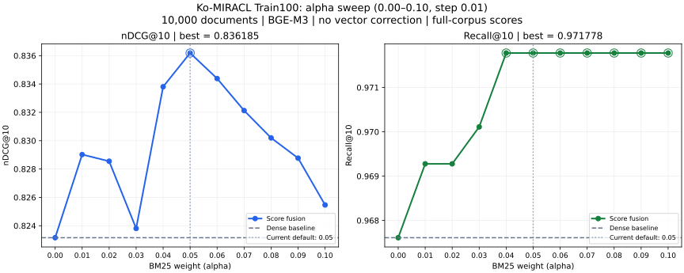

# Score fusion 실험 결과

Issue #17의 결론: **α=0.05, 벡터 보정 없음**을 기본값으로 유지한다.
Ko-StrategyQA nDCG@10은 기존 RRF 대비 **+0.066928**, Dense 대비 **+0.006025**다.
FastAPI·Streamlit은 기존 RRF를 사용하며, 서비스 통합은 이번 범위에 포함하지 않는다.

## 데이터셋별 평가 요약

평가 데이터셋은 **Ko-MIRACL, Ko-StrategyQA 두 종류**다. 아래는 고정한 α=0.05의 dev 평가 결과이며,
Ko-MIRACL Train100은 α 선정용으로 사용했다. 모든 구성의 Dense 모델은 BGE-M3다.

**Mean ms·P95 ms는 캐시된 쿼리 벡터를 사용하는 CPU 검색·결합 시간**으로, 모델 추론·초기화·HTTP는 제외한다.
품질은 각 dev 쿼리 전체에서 평가했고, 시간은 **warm-up 1회 후** 데이터셋별 25쿼리 × 3회(방법당 75표본) 측정했다.
GPU 추론을 포함한 E2E 시간은 아래 별도 절에 제시한다. `—`는 시간을 측정하지 않은 구성이다.

### Ko-MIRACL Dev50

문서 10,000개 · 쿼리 50개. 관련 문서를 포함한 subset이며 공식 전체 corpus 성능은 아니다.

| 모델 / 방식 | Recall@5 | Recall@10 | MRR@10 | nDCG@10 | Mean ms | P95 ms |
|---|---:|---:|---:|---:|---:|---:|
| Dense | 0.813667 | 0.958333 | 0.861024 | 0.854857 | 4.391 | 6.519 |
| 기존 RRF (양쪽 Top-10, k=60) | 0.765333 | 0.927667 | 0.790571 | 0.784433 | 7.493 | 12.042 |
| Score fusion (α=0.05, 최종 채택) | 0.815333 | 0.968333 | 0.881190 | 0.864903 | 3.604 | 5.301 |
| Score fusion + 벡터 보정 | 0.819333 | 0.972333 | 0.898524 | 0.883132 | 3.433 | 5.262 |
| 전체 후보 RRF (진단용, k=60) | 0.798667 | 0.941667 | 0.786524 | 0.799224 | — | — |

원본: [miracl-dev.json](experiments/score-fusion/miracl-dev.json).

### Ko-StrategyQA dev

문서 9,251개 · 쿼리 592개.

| 모델 / 방식 | Recall@5 | Recall@10 | MRR@10 | nDCG@10 | Mean ms | P95 ms |
|---|---:|---:|---:|---:|---:|---:|
| Dense | 0.813461 | 0.852031 | 0.811159 | 0.794055 | 2.268 | 3.544 |
| 기존 RRF (양쪽 Top-10, k=60) | 0.770781 | 0.840066 | 0.739329 | 0.733152 | 4.615 | 6.312 |
| Score fusion (α=0.05, 최종 채택) | 0.813320 | 0.858647 | 0.816558 | 0.800080 | 3.248 | 4.199 |
| Score fusion + 벡터 보정 | 0.813743 | 0.854424 | 0.813390 | 0.797141 | 3.424 | 4.751 |
| 전체 후보 RRF (진단용, k=60) | 0.742077 | 0.810405 | 0.736062 | 0.719689 | — | — |

원본: [strategyqa.json](experiments/score-fusion/strategyqa.json).

## 평가 조건

2026-10-14 실행 결과다. 품질·CPU 시간은 캐시 벡터 기반이며, GPU 추론 포함 시간은 별도로 측정했다.

| 데이터 | 문서 | 쿼리 | 용도 |
|---|---:|---:|---|
| Ko-MIRACL Train100 | 10,000 | 100 | α 선정 |
| Ko-MIRACL Dev50 | 같은 10,000 | 50 | 고정 α 확인·보정 비교 |
| Ko-StrategyQA dev | 전체 9,251 | 592 | 고정 α 확인·보정 비교 |

- BGE-M3 FP32·L2 정규화 벡터, 동일한 문서 ID·순서·`title + "\n" + text`를 사용했다.
- BM25: `char_wb` 2–4gram, Lucene 방식, `k1=1.5`, `b=0.75`.
- 기존 RRF: 양쪽 Top-10, `k=60`. Score fusion: 전체 corpus의 Dense 점수 + α × BM25/쿼리별 corpus 최대 BM25. 최대값이 0 이하면 BM25 기여도는 0이다.
- 지표: 양의 qrel을 관련 문서로 보는 binary nDCG@10·Recall@10의 쿼리별 평균.
- MIRACL은 관련 문서를 포함해 만든 10k subset이며 공식 전체 corpus 성능이 아니다.

모델 revision과 인코딩 설정은 [MIRACL](experiments/score-fusion/encoding/miracl10k.json)·[StrategyQA](experiments/score-fusion/encoding/strategyqa.json)에 있다.
StrategyQA 원본과 내용이 일치하는 데이터셋 revision은 `7cececfcc209fc836e08d6ab7584cba776847cfa`이며,
원본 3개 파일의 해시 대조 근거는 [데이터셋 검증 기록](experiments/score-fusion/encoding/strategyqa-dataset.json)에 있다.

## 검색 품질

| 구성 | Train100 nDCG@10 | Dev50 nDCG@10 | Ko-StrategyQA nDCG@10 |
|---|---:|---:|---:|
| Dense | 0.823154 | 0.854857 | 0.794055 |
| 기존 RRF (양쪽 Top-10, k=60) | 0.746300 | 0.784433 | 0.733152 |
| Score fusion (α=0.05) | 0.836185 | 0.864903 | 0.800080 |
| Score fusion + 벡터 보정 | 0.839313 | 0.883132 | 0.797141 |
| 전체 후보 RRF (진단용, k=60) | 0.732169 | 0.799224 | 0.719689 |

| 구성 | Train100 Recall@10 | Dev50 Recall@10 | Ko-StrategyQA Recall@10 |
|---|---:|---:|---:|
| Dense | 0.967611 | 0.958333 | 0.852031 |
| 기존 RRF | 0.941444 | 0.927667 | 0.840066 |
| Score fusion (α=0.05) | 0.971778 | 0.968333 | 0.858647 |
| Score fusion + 벡터 보정 | 0.970111 | 0.972333 | 0.854424 |
| 전체 후보 RRF | 0.885444 | 0.941667 | 0.810405 |


Ko-StrategyQA에서 RRF 대비 216쿼리 개선·34쿼리 악화, Dense 대비 71쿼리 개선·53쿼리 악화다.
집계 원본: [Train100](experiments/score-fusion/miracl-train.json) · [Dev50](experiments/score-fusion/miracl-dev.json) · [StrategyQA](experiments/score-fusion/strategyqa.json).

## 왜 RRF보다 score fusion이 나았는지 분석

RRF는 문서 간 실제 점수 차이를 반영하지 않고 두 검색기의 순위를 결합한다.
Score fusion은 Dense 점수 차이를 유지하면서 BM25를 제한된 보조 신호로 사용해,
Dense가 이미 찾은 관련 문서를 덜 밀어내고 점수가 가까운 문서 사이에서는 어휘 일치 정보를 반영했다.
RRF의 후보 범위를 넓혀도 성능이 회복되지 않아, 후보 확대만으로 개선을 설명하기는 어렵다.
다만 가중 RRF도 Dense 중심으로 조정하면 기존 RRF의 손실을 해소했으므로, 점수 기반 결합 자체의 우월성은 확정할 수 없다.
이 해석은 현재 모델·데이터·평가 설정에 한정한다.

수식, 질의별 정량 분석, 실제 사례, 신뢰구간과 적용 한계는
[왜 RRF보다 score fusion이 나았는지 상세 분석](SCORE_FUSION_ANALYSIS.md)에 정리했다.

## 최종 설정 선정 근거

### α=0.05 선정

과거 실험에서 사용한 α=0.05를 기본 후보로 두고, 현재 보고서에서는 같은 Train100에서
보정 없이 **0.00~0.10을 0.01 간격**으로 비교해 채택 근거를 재확인했다.
과거 저장소에는 표준화 결합·벡터 보정·학습형 결합 등 더 넓은 탐색도 있으며,
이 표를 전체 연구가 11개 후보만 비교한 최초 선정 이력으로 해석하지 않는다.
0.05의 nDCG@10이 **0.836185**로 가장 높았고, 0.04는 0.833805, 0.06은 0.834385였다.
Recall@10은 0.04~0.10에서 0.971778로 같았다. Dev50·StrategyQA에서는 재튜닝하지 않았다.
이 범위의 최고값이며, 전역 최적값이나 통계적 유의성을 확인한 결과는 아니다.



후보별 품질·latency: [sweep 원본](experiments/score-fusion/miracl-alpha-sweep.json).
α=0도 BM25를 계산하므로 Dense 단독의 실행시간과는 다르다.

### 벡터 보정 제외

Corpus 평균 제거 → 상위 PCA 8개 방향을 0.25만큼 축소 → L2 정규화를 적용했다.
MIRACL에서는 개선됐지만 StrategyQA nDCG@10은 **0.800080 → 0.797141**로 하락했다.
따라서 보정은 평가용으로만 유지한다.

## CPU 검색·결합 시간

Intel i3-12100F, Linux/WSL2, CPU 2스레드. 데이터별 25쿼리 × 3회, warm-up 1회,
방법 순서 교대, 방법당 75표본이다. **쿼리 벡터는 캐시를 사용하며 모델 추론·초기화·HTTP는 제외한다.**

| 구성 | Dev50 평균 ms | Dev50 P95 ms | Ko-StrategyQA 평균 ms | Ko-StrategyQA P95 ms |
|---|---:|---:|---:|---:|
| Dense | 4.391 | 6.519 | 2.268 | 3.544 |
| 기존 RRF | 7.493 | 12.042 | 4.615 | 6.312 |
| Score fusion | 3.604 | 5.301 | 3.248 | 4.199 |
| Score fusion + 보정 | 3.433 | 5.262 | 3.424 | 4.751 |


Dense는 FAISS, score fusion은 NumPy 전체 내적을 사용하므로 검색 구현 차이도 포함된다.
쿼리 보정은 측정에 포함하며, 보정 후 시간이 줄어든 경우는 측정 변동으로 해석한다.
전체 후보 RRF는 품질만 측정했다.

## 추론 포함 End-to-End 검색 latency

Ko-MIRACL Dev50에서 **쿼리 임베딩 시작부터 Top-10 반환까지** 측정했다.
Intel i3-12100F / RTX 4060, Linux/WSL2, CPU 2스레드, BGE-M3 FP32,
max length 8192, batch size 1, TF32 비활성화 조건이다.
방법당 warm-up 10회 후 50쿼리 × 10회, 순서를 교대하며 500표본씩 수집했다.

| 구성 | Mean ms | Median ms | P95 ms | 표본 |
|---|---:|---:|---:|---:|
| Dense | 22.004 | 20.430 | 31.190 | 500 |
| RRF | 24.117 | 22.575 | 35.033 | 500 |
| Score fusion (α=0.05) | 21.191 | 19.736 | 30.747 | 500 |


- 쿼리는 방법·요청마다 새로 인코딩한다. CUDA는 측정 시작 직전과 임베딩 완료 후 동기화한다.
- 평균 임베딩/검색·결합 시간(ms): Dense **18.166/3.838**, RRF **18.100/6.017**, score fusion **18.350/2.841**.
- 모델·인덱스 초기화, HTTP·직렬화는 제외한다. RRF는 벤치마크에서 embedding-first로 실행한다.
- 단일 세션·단일 요청 측정이다. 서버 응답시간·동시 부하 성능이나 속도 차이의 통계적 유의성을 검증한 것은 아니다.

Score fusion의 평균이 가장 낮았으며, 세 방법 모두 임베딩이 대부분의 시간을 차지했다.
[실측 원본](experiments/score-fusion/miracl-dev-e2e.json)에 상세 조건·단계별 통계·해시가 있다.
[산출물 검증](experiments/score-fusion/miracl-dev-e2e-verification.json)에서 1,500표본의 통계·해시,
반복별 순위 일관성과 기존 Dev50 품질 일치를 확인했다.

## 재현 및 검증

캐시 준비·기본 품질 평가 명령은 [SCORE_FUSION.md](SCORE_FUSION.md)를 따른다.
아래 명령은 저장소 루트에서 실행하며, 벤치마크 재실행 시 새 `--output` 경로를 지정한다.

### GPU 추론 포함 측정

CUDA와 고정 BGE-M3 모델이 필요하다. 모델이 로컬 캐시에 없으면 최초 다운로드가 필요하며,
측정 중 다른 모델 실행·테스트·GPU 작업을 함께 실행하지 않는다.

```bash
.venv/bin/python -m scripts.prepare_score_fusion_cache --verify-only
.venv/bin/python -m scripts.benchmark_score_fusion_e2e \
  --cache-dir artifacts/score-fusion-cache/miracl10k \
  --device cuda:0 --threads 2 --warmup 10 --repeats 10 \
  --output artifacts/score-fusion-e2e/miracl-dev
```

### 기존 가중치 비교 재현

```bash
SCORE_CACHE=artifacts/score-fusion-cache
uv run --locked --extra sparse --extra dense python -m scripts.benchmark_score_fusion \
  --cache-dir "$SCORE_CACHE/miracl10k" --split train \
  --expected-summary docs/experiments/score-fusion/miracl-alpha-sweep.json \
  --weights 0 0.01 0.02 0.03 0.04 0.05 0.06 0.07 0.08 0.09 0.10 --repeats 3 \
  --output artifacts/score-fusion-final/miracl-alpha-sweep

```

테스트·정적 검사 기록은 [verification.json](experiments/score-fusion/verification.json)에 있다.
기록된 커밋·날짜 기준의 결과이며, 현재 작업 트리의 검증을 보장하지 않는다.
원시 순위·시간은 `artifacts/score-fusion-final/`과 `artifacts/score-fusion-e2e/miracl-dev/`에 로컬 보존한다.
