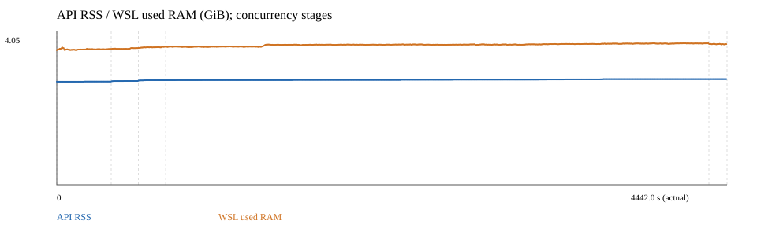
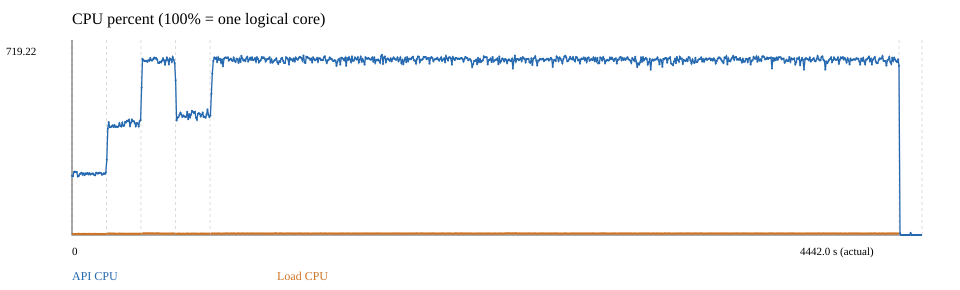
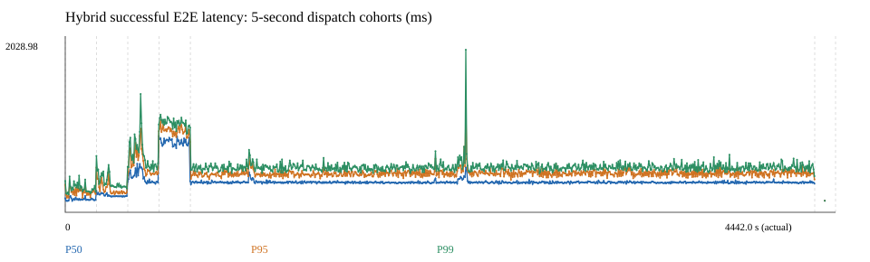

# Hybrid 검색 지속 부하 검증 — 2026-10-20

4클라이언트로 1시간 동안 37,081건을 처리했으며 실패·timeout·미완료 요청은 없었다.
초반과 후반의 응답시간·FD·스레드는 유사했고, RSS 중앙값은 약 28MiB 증가했다.
실행은 완료했지만 자원 수집률이 자체 기준에 미달해 기존 자동 판정은 **보류(inconclusive)**다.

## 실행 조건

- 코드: `2e252da1dd0d8b5d7a3bdc57096fd9bb0c2b9145`
- 시간: 2026-10-20 22:25:21~23:39:23 KST, 약 74분(준비 제외)
- 환경: WSL2 Linux, Python 3.12.3, 논리 CPU 8개, Uvicorn worker 1개, CPU 추론
- 입력: Ko-MIRACL 10,000문서, MIRACL dev 50질의 순환, `POST /search`, `method=hybrid`, `top_k=10`
- 모델: BGE-M3, revision `5617a9f61b028005a4858fdac845db406aefb181`; 문서 벡터 재사용, 질의는 매번 임베딩
- 스레드 설정: `OMP_NUM_THREADS=2`, `MKL_NUM_THREADS=2`, `OPENBLAS_NUM_THREADS=2`
- 부하: 동시 클라이언트 1→2→4→8 각 3분 → 4클라이언트 60분 → 회복 관찰 2분
- 방식: 응답 후 다음 요청을 보내는 closed-loop, RPS 제한·실패 재시도 없음; 자원 수집 목표 주기 5초

## 요청 결과

| 구간 | 동시 클라이언트 | 성공 요청 | 실패 | 성공 RPS | P95(ms) |
| --- | ---: | ---: | ---: | ---: | ---: |
| stress-1 | 1 | 1,018 | 0 | 5.65 | 272.8 |
| stress-2 | 2 | 1,596 | 0 | 8.86 | 324.2 |
| stress-4 | 4 | 1,616 | 0 | 8.95 | 668.3 |
| stress-8 | 8 | 1,653 | 0 | 9.15 | 1044.3 |
| hold-4 | 4 | 37,081 | 0 | 10.30 | 507.0 |

1시간 유지 구간의 P50은 373.1ms, P99는 590.1ms다.
RPS는 해당 구간에서 시작한 성공 요청 수 / 3,600초이며, 종료 후 0.445초 내 회수한 잔여 요청도 포함한다.
회복 구간의 확인 요청 2건도 성공했다.

## 리소스와 시간 경과

유지 구간의 처음·마지막 10분을 비교했다. 응답시간은 동일 질의·top_k의 6,165쌍 기준이며,
자원 수치는 각 구간의 중앙값이다.

| 지표 | 초반 10분 | 후반 10분 |
| --- | ---: | ---: |
| P95 응답시간 | 503.2ms | 505.2ms |
| API RSS | 3,068.1MiB | 3,096.0MiB |
| API CPU | 701.7% | 700.4% |
| 열린 FD | 19 | 19 |
| 스레드 | 18 | 18 |

유지 구간 RSS 증가 추세는 약 34.3MiB/h다. 이 관찰만으로 메모리 누수 유무를 확정하지 않는다.
회복 마지막 60초에는 CPU 중앙값이 0.2%, FD 15개, 스레드 12개였고 RSS는 약 3,096MiB였다.
준비 구간에는 모델 로딩이 포함되어 있어 회복 전후 메모리 반환 여부의 기준으로 사용하지 않았다.
CPU 100%는 논리 CPU 한 개를 뜻한다.

## 범위와 원본 로그

자원 로그는 본 실행에서 877개 표본을 수집했다. 5초 구간 기준 수집률은 98.65%로
자체 기준 99%에 미달했고, 최대 표본 간격은 5.205초였다. 따라서 자동 판정 보류를 유지한다.
API와 부하 발생기는 같은 장비에서 실행했다. 이번 결과는 해당 환경의 1시간 관찰이며,
운영 환경의 최대 처리량·장기 누수 부재·브라우저/Streamlit 세션 안정성까지 검증하지 않는다.

- [요청 원본 CSV(gzip)](requests.csv.gz): 준비·단계별 부하·유지·회복 요청의 시작/완료 행을 원본 그대로 합쳤다. `phase`로 구분한다.
- [리소스 원본 CSV](resources.csv): CPU·RSS·호스트 메모리·FD·스레드 등. `elapsed < 0`은 준비 구간이며, 호스트 메모리는 WSL 기준이다.
- [질의 목록](queries.jsonl): 부하에 사용한 50개 질의.

로그의 `utc`는 UTC이며 KST는 9시간을 더한다. 이 폴더는 결과 증빙만 보관하며 실행기 사본과 중복 집계는 제외했다.
